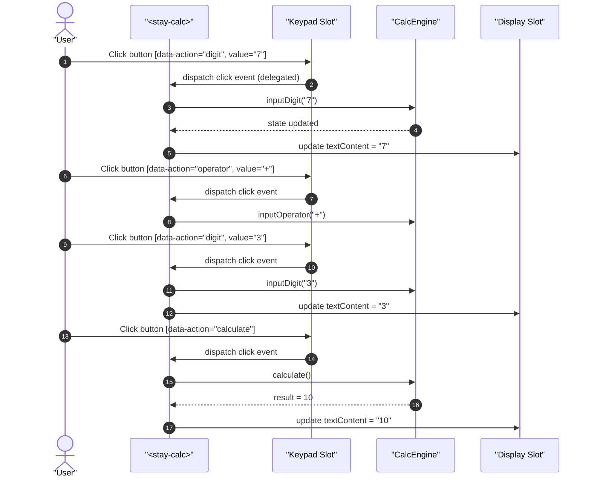
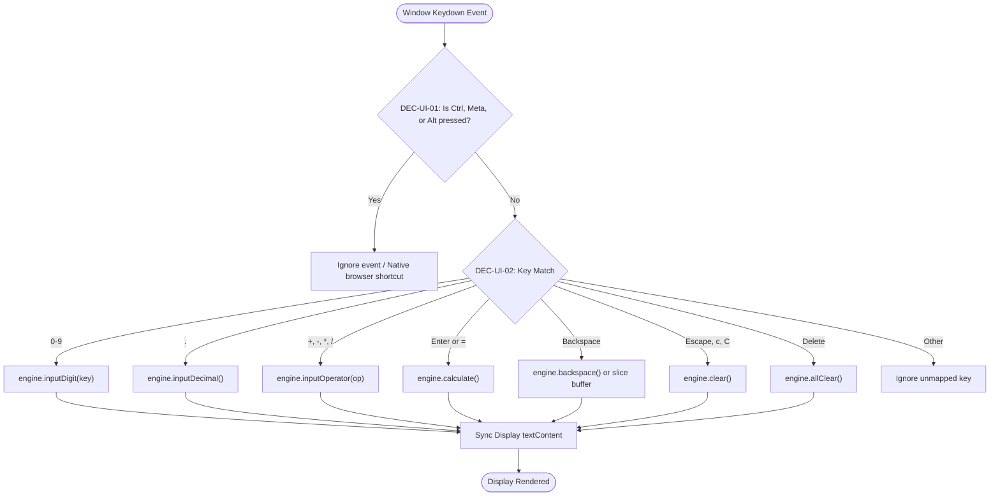

# User Flow: Accessible UI and Keyboard Navigation Flow

Authoritative screen states, interaction logic, physical keyboard event mapping, Declarative Shadow DOM slot projection flow, and error recovery for `<stay-calc>`.

---

## 1. Flow Overview & Interaction Bounds
- **Goal**: Provide responsive, accessible UI and keyboard navigation for arithmetic calculations with DSD slot projection and mobile zero-overflow.
- **Primary Surface**: `<stay-calc>` Autonomous Custom Element in `src/components/stay-calc.ts`.
- **Actor Role**: `StandardUser`
- **Entry Trigger**: User clicks/taps keypad buttons or types physical keyboard keys.
- **Exit Outcome**: Synchronous update of Shadow DOM display slot and internal engine state.
- **Storage Tier**: In-memory instance registers (`CalcEngine`).
- **Latency & SLA Bounds**: Immediate synchronous DOM display update (`<= 1ms`).

---

## 2. Entry Points

| Entry ID | Trigger / Source | Preconditions | Initial Surface | Inbound Flow |
| :--- | :--- | :--- | :--- | :--- |
| `ENT-UI-01` | Keypad Button Click / Tap | User clicks button inside `<stay-calc>` | Keypad Slot | `FLW-UI-01` |
| `ENT-UI-02` | Physical Keyboard Keydown | Window captures `keydown` event | Global Window | `FLW-UI-02` |
| `ENT-UI-03` | Clear / All Clear Action | User clicks `C`/`AC` or presses `Escape`/`c` | Keypad / Keyboard | `FLW-UI-03` |

---

## 3. Canonical Flow Sequences

### Flow A: Keypad Interaction & Calculation Sequence

### Flow B: Physical Keyboard Event Routing

---

## 4. Screen States & Slots

| Screen / Slot State | Description | Active Content | Status Indicator |
| :--- | :--- | :--- | :--- |
| `SCR-DISPLAY-NORMAL` | Standard buffer or calculated result display | Tabular numeral string (e.g., `"0"`, `"42"`) | Clean / unlocked |
| `SCR-DISPLAY-ERROR` | Division by zero error state | `"Cannot divide by zero"` | Locked error indicator |
| `SCR-KEYPAD-GRID` | 4-column tactile button keypad | 16-19 pill buttons (`0-9`, `.`, `+`, `-`, `*`, `/`, `=`, `C`, `AC`) | Tactile `:active` depression |

---

## 5. Decisions & Branching Rules

- **`DEC-UI-01` (Modifier Key Guard)**: If `event.ctrlKey || event.metaKey || event.altKey` is true, do not intercept or call `event.preventDefault()`. Allow native copy, paste, refresh, or developer tools shortcuts.
- **`DEC-UI-02` (Error State Lockout)**: If engine is locked due to division by zero, all numeric and operator inputs are rejected by `CalcEngine`. Display remains `"Cannot divide by zero"` until user triggers `C` or `AC`.
- **`DEC-UI-03` (Slot Projection Fallback)**: If consumers provide projected children in `
` or `
`, `<stay-calc>` projects them through `<slot>`. Otherwise, default Shadow DOM template elements render.

---

## 6. Recovery & Error Safeguards

- **`REC-UI-01` (Division by Zero Recovery)**: Pressing `C` or `Escape` unlocks engine state, resets buffer to `"0"`, and restores interactive calculation.
- **`REC-UI-02` (Mobile Viewport Safeguard)**: CSS grid on keypad container enforces `min-width: 0` and flexible `1fr` columns so that container does not exceed mobile screen bounds (`scrollWidth <= clientWidth` at 320px).
