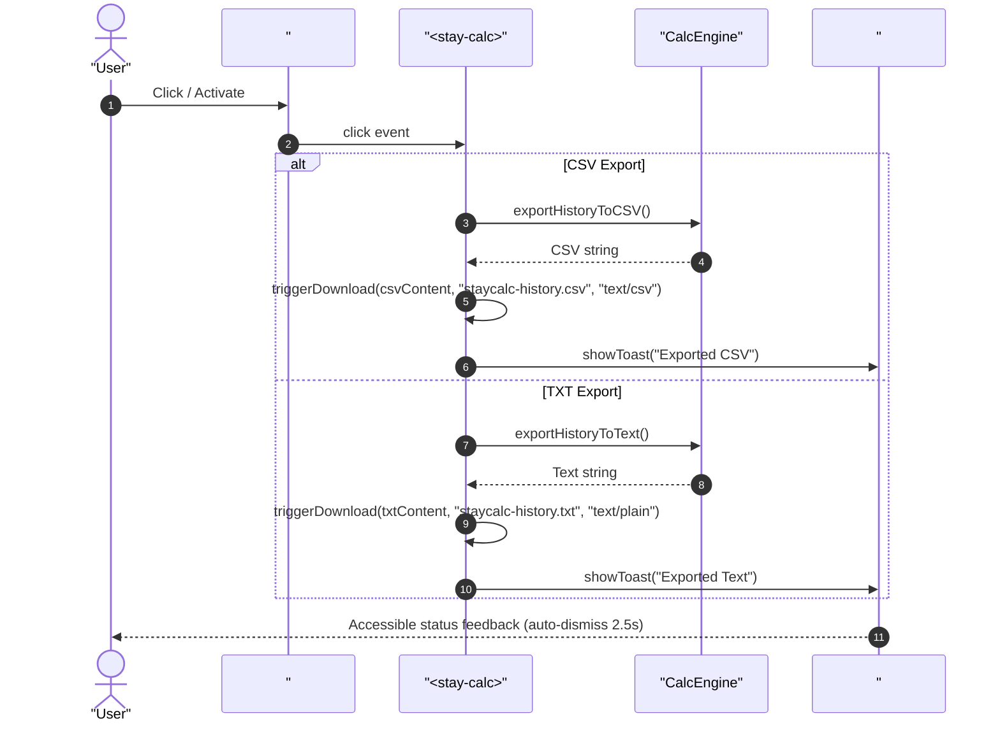
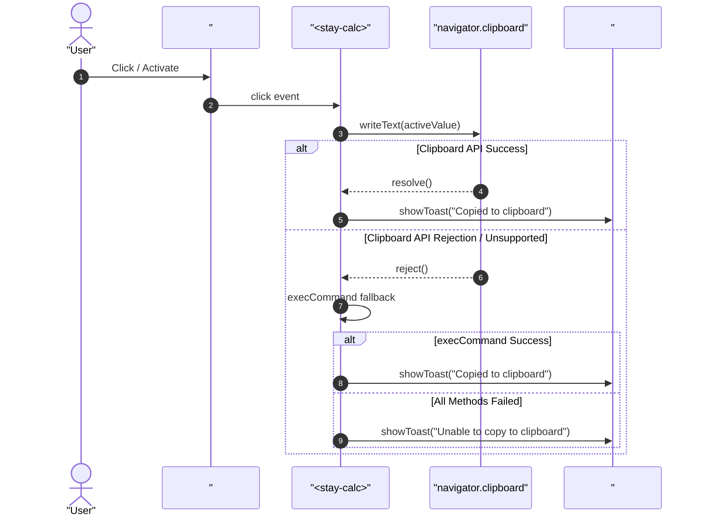

# User Flow: Audit Tape Export & Clipboard Synchronization Flow

Authoritative screen states, interaction sequences, clipboard fallback transitions, and toast lifecycle for `<stay-calc>` audit tape export and clipboard synchronization.

---

## 1. Flow Overview & Interaction Bounds
- **Goal**: Enable users to export history tape records as CSV or plain text, copy live calculation results to the system clipboard, and receive accessible, auto-dismissing feedback without disrupting calculation flow.
- **Primary Surface**: `<stay-calc>` autonomous custom element in `src/components/stay-calc.ts` and `CalcEngine` in `src/engine/calc-engine.ts`.
- **Actor Role**: `StandardUser`
- **Entry Triggers**:
  - Click or keyboard activate `#export-csv` button.
  - Click or keyboard activate `#export-txt` button.
  - Click or keyboard activate `#copy-result` button.
- **Exit Outcomes**:
  - File download prompt initiated for CSV or TXT file.
  - Text placed on system clipboard and `#calc-toast` displays confirmation.
  - On clipboard error, `#calc-toast` displays polite warning.
- **Storage Tier**: In-memory instance buffer (`CalcEngine.history`).
- **Latency & SLA Bounds**: Immediate synchronous DOM update (`<= 1ms`), clipboard promise resolution within browser limits.

---

## 2. Entry Points

| Entry ID | Trigger / Source | Preconditions | Initial Surface | Inbound Flow |
| :--- | :--- | :--- | :--- | :--- |
| `ENT-EXP-01` | `#export-csv` Click / Enter | History drawer open | History Drawer Actions | `FLW-EXP-01` |
| `ENT-EXP-02` | `#export-txt` Click / Enter | History drawer open | History Drawer Actions | `FLW-EXP-02` |
| `ENT-EXP-03` | `#copy-result` Click / Enter | History drawer open or display active | History Drawer / Display Actions | `FLW-EXP-03` |

---

## 3. Canonical Flow Sequences

### Flow A: Audit Tape Export Sequence (CSV / TXT)

### Flow B: Clipboard Copy & Polite Toast Notification Sequence

---

## 4. Screen Transitions & State Machine

| Screen ID | Surface / View | Display State | Available Actions | Next States |
| :--- | :--- | :--- | :--- | :--- |
| `SCR-EXP-01` | History Drawer Actions | Action bar visible in drawer header | `#export-csv`, `#export-txt`, `#copy-result`, `#history-clear` | `SCR-EXP-02`, `SCR-EXP-03` |
| `SCR-EXP-02` | Browser Download | Download initiated | User saves or opens downloaded file | `SCR-EXP-01` |
| `SCR-EXP-03` | Toast Active State | `#calc-toast` visible with `show` class | Live region announces text to assistive technology | `SCR-EXP-04` (after 2.5s) |
| `SCR-EXP-04` | Toast Dismissed State | `#calc-toast` hidden (`opacity: 0`, pointer-events none) | Normal calculator operations | `SCR-EXP-01` |

---

## 5. Decision Trees & Guard Rails

- **`DEC-EXP-01` (Empty History Export Handling)**:
  - If `engine.getHistory().length === 0`:
    - CSV export returns header row only: `timestamp,expression,result\n`.
    - Text export returns notice: `(No calculation entries recorded)\n`.
    - Trigger download and display corresponding toast without crashing.
- **`DEC-EXP-02` (RFC 4180 CSV Quote Escaping)**:
  - If expression contains `,` or `"`:
    - Escape internal `"` as `""`.
    - Enclose entire expression in double quotes (e.g., `"2 * (3 + 4) = 14"`).
- **`DEC-EXP-03` (Clipboard API Fallback Chain)**:
  - Check if `navigator.clipboard && navigator.clipboard.writeText`:
    - Call `navigator.clipboard.writeText(value)`.
  - If rejected or undefined:
    - Attempt `document.execCommand('copy')` with hidden textarea.
  - If both fail:
    - Notify user via toast: `"Unable to copy to clipboard"`. Do not throw unhandled rejection.
- **`DEC-EXP-04` (Toast Debounce & Timer Renewal)**:
  - If toast is already visible when a new action occurs:
    - Cancel active timeout (`clearTimeout(this._toastTimeout)`).
    - Update text content and re-trigger animation.
    - Set fresh 2500ms auto-dismiss timer.

---

## 6. Recovery Loops & Friction Points

- **`REC-EXP-01` (Insecure Context / Clipboard Denied)**:
  - Condition: Browser running on non-HTTPS host or user denied clipboard permissions.
  - Recovery: Offscreen textarea copy fallback executed immediately. If rejected, clear toast message shown without application freeze.
- **`REC-EXP-02` (Popup Blocker / Object URL Block)**:
  - Condition: Browser prevents automatic anchor click download.
  - Recovery: Clean up created object URL using `URL.revokeObjectURL(url)` in a `finally` block or scheduled microtask.
