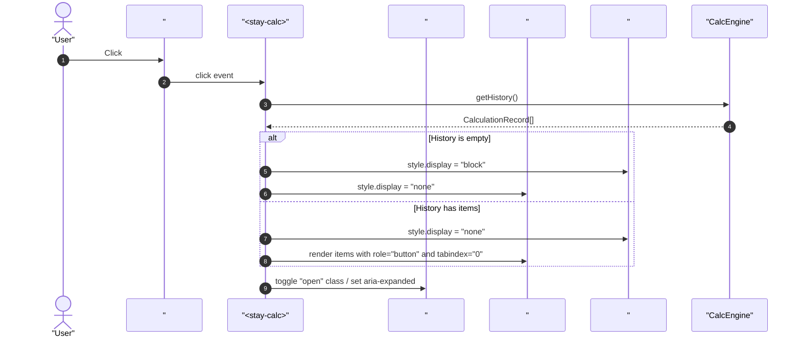
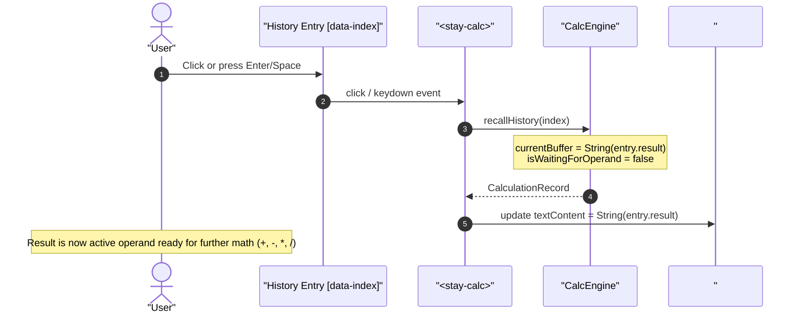
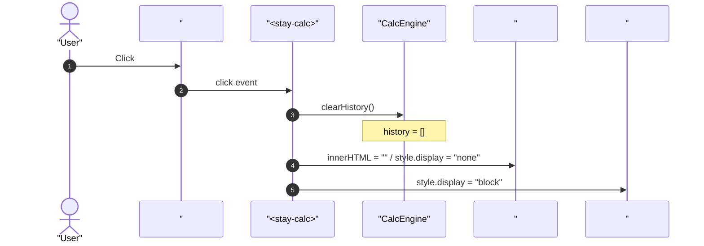
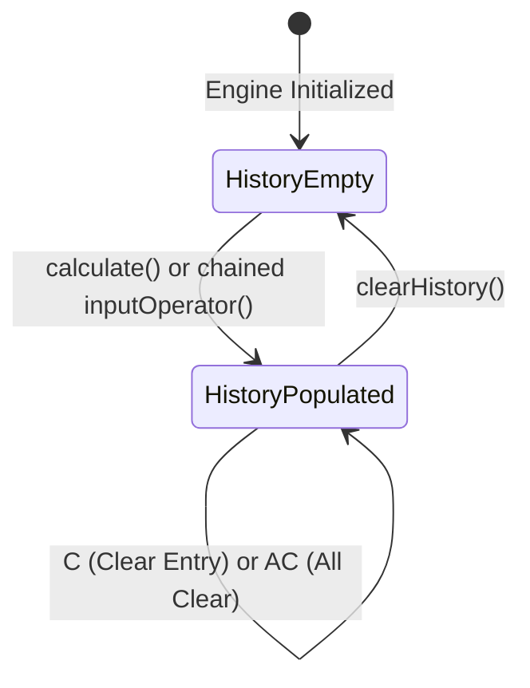

# User Flow: Calculation History Tape Flow

Authoritative screen states, interaction sequences, audit buffer transitions, and drawer lifecycle for `<stay-calc>` calculation history tape.

---

## 1. Flow Overview & Interaction Bounds
- **Goal**: Enable users to view past calculations, recall previous results into the active calculation register, and clear the audit tape without disrupting running calculations.
- **Primary Surface**: `<stay-calc>` Autonomous Custom Element in `src/components/stay-calc.ts` and `CalcEngine` in `src/engine/calc-engine.ts`.
- **Actor Role**: `StandardUser`
- **Entry Trigger**: User clicks `#history-toggle`, clicks a history item, presses `Enter`/`Space` on a focused item, or clicks `#history-clear`.
- **Exit Outcome**: Synchronous update of drawer visibility, active calculation register, or history tape.
- **Storage Tier**: In-memory instance buffer (`CalcEngine.history`).
- **Latency & SLA Bounds**: Immediate synchronous DOM update (`<= 1ms`).

---

## 2. Entry Points

| Entry ID | Trigger / Source | Preconditions | Initial Surface | Inbound Flow |
| :--- | :--- | :--- | :--- | :--- |
| `ENT-HIST-01` | `#history-toggle` Click | Custom element mounted | Drawer Header | `FLW-HIST-01` |
| `ENT-HIST-02` | History Entry Click / Keyboard | Drawer open, entries exist | `#history-list` | `FLW-HIST-02` |
| `ENT-HIST-03` | `#history-clear` Click | Drawer open | `#history-panel` | `FLW-HIST-03` |

---

## 3. Canonical Flow Sequences

### Flow A: Drawer Toggle & Entry Rendering Sequence

### Flow B: Interactive History Recall Sequence

### Flow C: Clear History Tape Sequence

---

## 4. State Transitions

---

## 5. Decision Points & Dynamic Recovery

- **`DEC-HIST-01` (History Entry Count Check)**:
  - *Condition*: `history.length === 0`.
  - *Action*: Render `#history-empty` message; disable or hide individual item actions gracefully.
- **`DEC-HIST-02` (FIFO Eviction Guard)**:
  - *Condition*: `this.history.length > 50`.
  - *Action*: Automatically shift off oldest record (`this.history.shift()`) before completing insertion.
- **`DEC-HIST-03` (Division by Zero Rejection)**:
  - *Condition*: Calculation evaluates to division by zero (`pendingOperator === "/" && currentOperand === 0`).
  - *Action*: Engine locks in error state; calculation is rejected and NEVER committed to history tape (`NEVER-CALC-007`).
- **`REC-HIST-01` (Empty History Recovery)**:
  - *Condition*: User triggers recall on empty history or out-of-bounds index.
  - *Action*: `recallHistory(index)` returns `null` safely without modifying active buffer or throwing exceptions.

---

## 6. Exit Points

| Exit ID | Destination | Verification Check |
| :--- | :--- | :--- |
| `EXT-HIST-01` | Active Operand State | `currentBuffer === String(recalledResult)`, `isWaitingForOperand === false` |
| `EXT-HIST-02` | History Cleared State | `getHistory().length === 0`, `#history-empty` visible |
| `EXT-HIST-03` | Drawer State Toggled | `#history-drawer.classList.contains("open")` matches `aria-expanded` |
