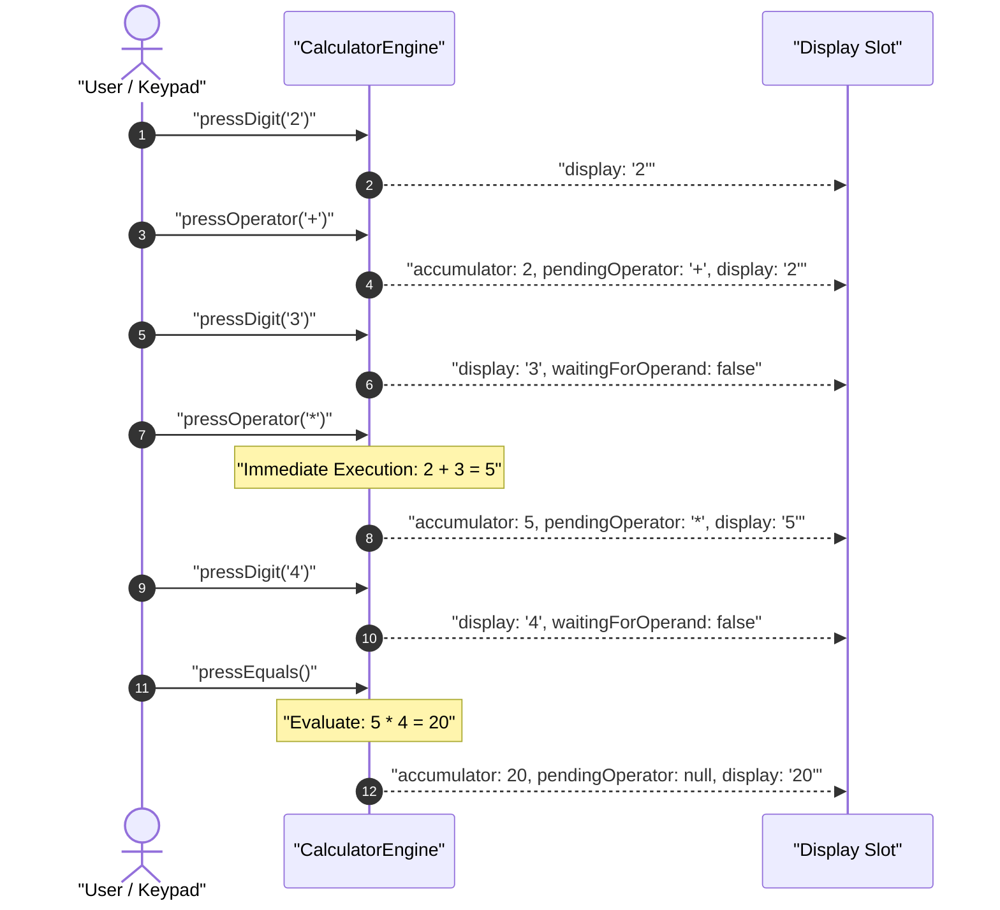
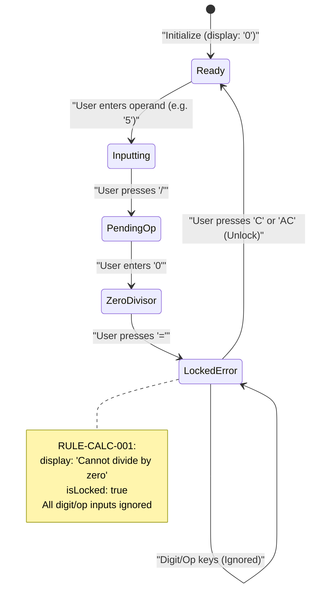
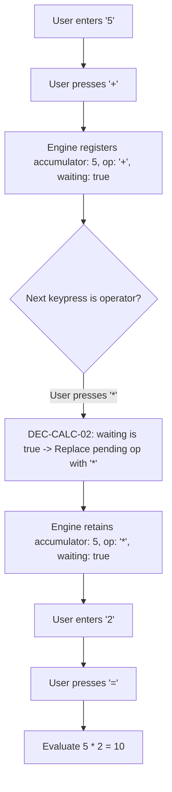

# User Flow: Precision Arithmetic Engine

Authoritative user interaction logic, state transitions, decision paths, and error recovery for the StayCalc arithmetic calculation engine.

---

## 1. Flow Overview & Interaction Bounds
- **Goal**: Ingest numeric input and mathematical operators, execute sequential left-to-right arithmetic operations, normalize decimal representations, and lock on division by zero.
- **Primary Surface**: `src/engine/` (dispatched by `src/components/stay-calc.ts`)
- **Actor Role**: `GeneralUser`
- **Entry Trigger**: User presses a numeric digit, operator key (`+`, `-`, `*`, `/`), equals (`=`), clear (`C`), or all clear (`AC`).
- **Exit Outcome**: Display buffer updated with current operand, running calculation result, or error notice (`"Cannot divide by zero"`).
- **Dual-Tier Draft Storage**: Transient calculation state maintained in-memory via `CalculatorState`; completed calculations committed to local history storage.
- **Latency & SLA Bounds**: Engine response time `<= 1ms` per operation, maintaining continuous 60fps interactivity.

---

## 2. Entry Points

| Entry ID | Trigger / Source | Preconditions | Initial Surface | Inbound Flow |
| :--- | :--- | :--- | :--- | :--- |
| `ENT-CALC-01` | Session initialization | Page load or `<stay-calc>` mount | `SCR-CALC-READY` | Display initialized to `"0"` |
| `ENT-CALC-02` | Digit or decimal input | Engine not in locked error state | `SCR-CALC-BUFFER` | Active operand accumulation |
| `ENT-CALC-03` | Operator key pressed | Valid numeric buffer | `SCR-CALC-OP` | Operator registration / immediate execution |
| `ENT-CALC-04` | Clear / All Clear key | Any engine state | `SCR-CALC-READY` | Register clearing & lock release |

---

## 3. Canonical Flow Sequences

### Flow A: Nominal Sequential Arithmetic (`2 + 3 * 4 = 20`)

### Flow B: Division by Zero & Recovery Loop

### Flow C: Consecutive Operator Replacement (`5 + * 2 = 10`)

---

## 4. Decision Points Matrix

| Decision ID | Decision Question | Evaluated At (Screen / Node) | Condition / Input | YES / Branch 1 Path | NO / Branch 2 Path | Failure / Undefined Law |
| :--- | :--- | :--- | :--- | :--- | :--- | :--- |
| `DEC-CALC-01` | Is engine locked by error? | `SCR-CALC-ERROR` | `state.isLocked === true` | Ignore key if not `C`/`AC` | Proceed to normal key handler | `RULE-CALC-001` |
| `DEC-CALC-02` | Is waiting for operand during operator press? | `SCR-CALC-OP` | `waitingForOperand === true` | Replace pending operator (`RULE-CALC-008`) | Execute pending operation immediately (`RULE-CALC-007`) | Preserve accumulator |
| `DEC-CALC-03` | Is divisor zero on division? | Evaluation routine | `op === '/' && divisor === 0` | Set `"Cannot divide by zero"` & lock | Compute decimal quotient & normalize | `RULE-CALC-001` |
| `DEC-CALC-04` | Does input buffer already have decimal point? | `SCR-CALC-BUFFER` | `buffer.includes('.')` | Ignore duplicate `.` | Append `.` to buffer | Prevent invalid float |

---

## 5. Recovery Flows & Error Loops

### `REC-CALC-01`: Zero Division Recovery Flow
- **Triggering Failure**: User attempts division by zero (`n / 0 =`).
- **Recovery Surface**: `SCR-CALC-ERROR`
- **User Actions Available**:
  1. **Clear (`C`)**: Clears error state, unlocks engine, resets display to `"0"`.
  2. **All Clear (`AC`)**: Clears error state, unlocks engine, flushes accumulator and pending operator to initial state.
- **Max Retry Bound**: Unlimited retries; engine remains deterministically locked until explicitly cleared.

---

## 6. Exit Points

| Exit ID | Destination Surface | Final User State | UI Feedback / Notification | Next Available Action |
| :--- | :--- | :--- | :--- | :--- |
| `EXT-CALC-01` | `SCR-CALC-READY` | Calculation Completed | Display renders formatted result | Next digit starts fresh calculation; operator chains result |
| `EXT-CALC-02` | `SCR-CALC-ERROR` | Error Locked | Display displays `"Cannot divide by zero"` | Clear (`C`) or All Clear (`AC`) required to resume |

---

## 7. Screen Flow & Surface Inventory

| Screen ID | Surface Type | Primary Interactive Elements | Inbound Transitions | Outbound Transitions |
| :--- | :--- | :--- | :--- | :--- |
| `SCR-CALC-READY` | Component State | Display buffer ("0" or result), Keypad | `ENT-CALC-01`, `ENT-CALC-04` | `SCR-CALC-BUFFER`, `SCR-CALC-OP` |
| `SCR-CALC-BUFFER` | Component State | Display showing active number input | `ENT-CALC-02` | `SCR-CALC-OP`, `SCR-CALC-READY` |
| `SCR-CALC-OP` | Component State | Display showing accumulator, active op | `ENT-CALC-03` | `SCR-CALC-BUFFER`, `SCR-CALC-ERROR` |
| `SCR-CALC-ERROR` | Component State | Locked display banner ("Cannot divide by zero") | `DEC-CALC-03` (Div by zero) | `SCR-CALC-READY` (via `C`/`AC`) |

---

## 8. References
- [Feature Specification](./feature.md)
- [Test Cases](./cases.md)
