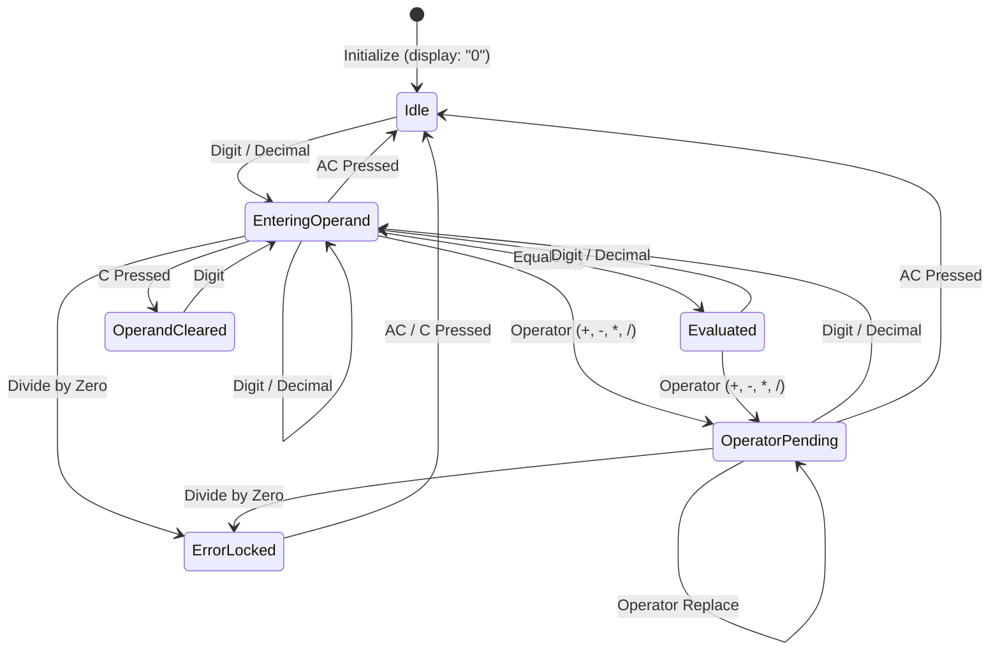

# Logic Flow: Precision Arithmetic Engine (F1)

## 1. Engine State Machine

## 2. Decision Tree (`DEC-*`)

- **`DEC-F1-001` (Input In Locked Error)**:
  - If state is `hasError: true`, any input other than `C` or `AC` is ignored.
- **`DEC-F1-002` (Operator Key Pressed)**:
  - If `waitingForOperand: true`, update `pendingOperator` to new operator (Operator replacement, `RULE-CALC-004`).
  - If `waitingForOperand: false` and `accumulator !== null`, evaluate pending operation immediately, display normalized result, store in accumulator, set `pendingOperator` to new operator, set `waitingForOperand: true`.
- **`DEC-F1-003` (Equals Key Pressed)**:
  - If `accumulator !== null` and `pendingOperator !== null`, calculate `accumulator <op> display`, format result, clear `pendingOperator`, set `waitingForOperand: true`.
- **`DEC-F1-004` (Division By Zero)**:
  - If operation is `/` and operand is `0`, set `hasError: true`, `errorMessage: "Cannot divide by zero"`, lock input.
