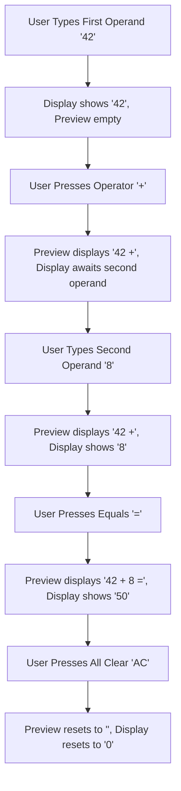

# User Flow: Formula Expression Preview Display (F10)

## 1. Flow Diagram

## 2. Interaction States
- **SCR-EXP-01 (Display Container Sub-Row)**: Sub-row `#expression-preview` rendered above `#display` with subtle text styling (`var(--calc-text-secondary)`).
- **DEC-EXP-01 (Continuous Operator Flow)**: Chaining operations dynamically appends or computes left-folded representations.
- **REC-EXP-01 (Error State Reflection)**: On division by zero or domain errors, preview retains error equation (e.g. `"10 / 0 ="`) while display indicates error message.
