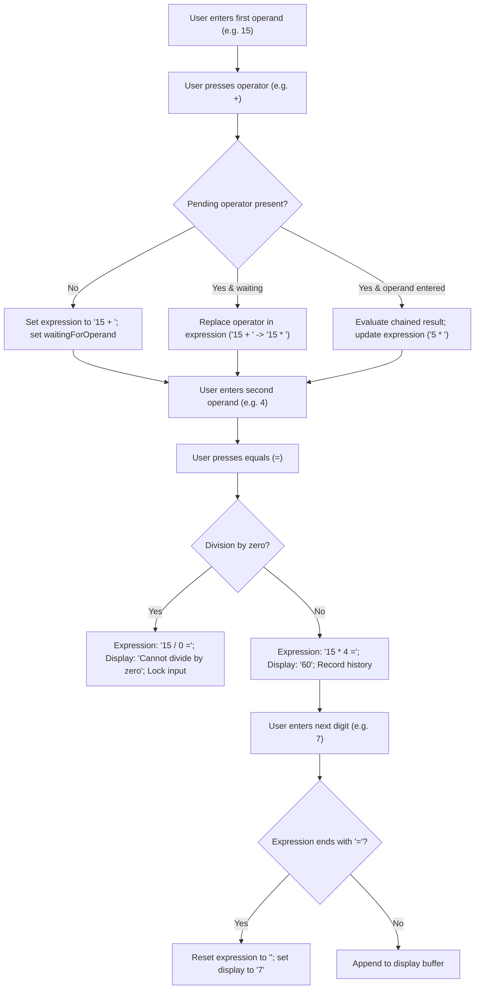
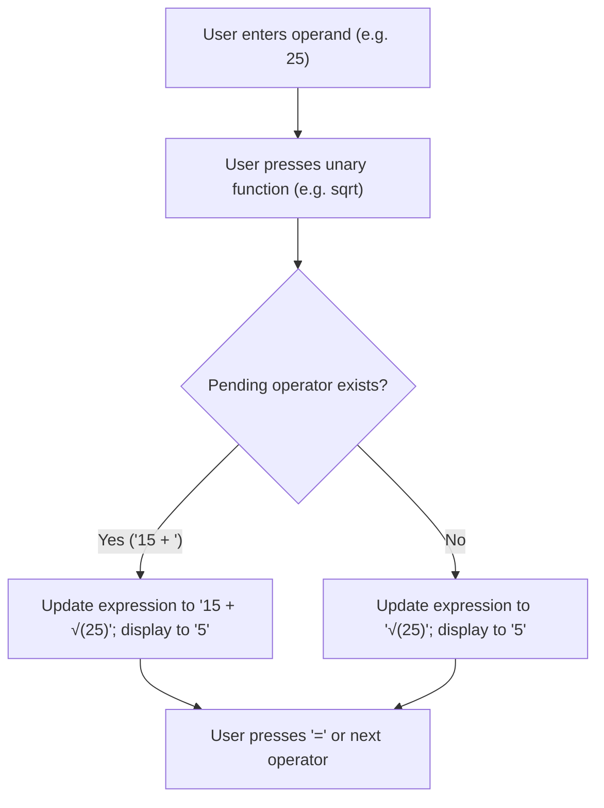

# User Flow: Formula Expression Preview Display

Authoritative user interaction logic, screen state transitions, decision branching, error recovery paths, and parse-safe visual workflows for Feature F10 (Formula Expression Preview Display).

---

## 1. Flow Overview & Interaction Bounds
- **Goal**: Provide real-time, continuous visual feedback of in-flight and completed arithmetic expressions in `#expressionPreview` directly above `#displayValue`, allowing users to maintain full mathematical context during complex multi-step computations.
- **Primary Surface**: `<stay-calc>` Digital Display Screen (`.display-screen`, `#expressionPreview`, `#displayValue`) and `CalculatorEngine` state machine (`src/engine/calculator-engine.ts`).
- **Actor Role**: `GeneralUser`, `StudentUser`, `ProgrammerUser`, `KeyboardPowerUser`, `ScreenReaderUser`
- **Entry Trigger**: User presses numeric digit, operator, unary function, or equals button/key.
- **Exit Outcome**: Expression preview row reflects active mathematical state; polite ARIA live region notifies screen readers; `calc-change` CustomEvent dispatches updated state with `expression`.
- **Latency & SLA Bounds**: DOM updates and state transitions execute synchronously in `<= 16ms` (1 animation frame).

---

## 2. Entry Points

| Entry ID | Trigger / Source | Preconditions | Initial Surface | Inbound Flow |
| :--- | :--- | :--- | :--- | :--- |
| `ENT-EXP-01` | Number / Digit Input (`0-9`, `A-F`, `.`) | Calculator mounted | Keypad or Keyboard | Checks if previous action was equals (`DEC-EXP-03`); updates display |
| `ENT-EXP-02` | Operator Input (`+`, `-`, `*`, `/`, `^`, bitwise) | Any calculation state | Keypad or Keyboard | Formulates or replaces pending operator in expression (`DEC-EXP-01`) |
| `ENT-EXP-03` | Equals Input (`=`, `Enter`) | Any calculation state | Keypad or Keyboard | Evaluates calculation and appends `"="` to expression (`DEC-EXP-02`) |
| `ENT-EXP-04` | Unary Function Input (`sqrt`, `sqr`, `sin`, `cos`, `tan`) | Valid numeric display | Keypad or Keyboard | Wraps active operand in unary syntax within expression (`DEC-EXP-04`) |
| `ENT-EXP-05` | Reset Input (`C`, `AC`, `Escape`) | Any calculation state | Keypad or Keyboard | Resets input buffer (`C`) or flushes entire expression to empty (`AC`) |

---

## 3. Screen States & Visual Presentations

| Screen ID | Expression Preview State | Display Value Presentation | Host / Shadow DOM State | Visual Layout & Contents |
| :--- | :--- | :--- | :--- | :--- |
| `SCR-EXPR-EMPTY` | Empty (`""`) | `"0"` or initial number | `#expressionPreview:empty` | Formula preview row maintains min-height without text; zero layout shift |
| `SCR-EXPR-ACTIVE` | Active formula prefix (e.g. `"15 + "` or `"15 + √(25)"`) | Current active operand or accumulator | `#expressionPreview` populated | Subdued text (opacity 0.7) right-aligned above active primary display |
| `SCR-EXPR-EQUALS` | Finalized formula with trailing `=` (e.g. `"15 * 4 ="`) | Evaluated result (e.g. `"60"`) or error message | `#expressionPreview` populated with trailing `=` | Shows full completed equation above evaluated answer; prepares for next input |

---

## 4. Decision Logic & Branching

| Decision ID | Condition / Check | Branch "Yes" Path | Branch "No" Path |
| :--- | :--- | :--- | :--- |
| `DEC-EXP-01` | Does expression already have a pending operator and is `waitingForOperand` true? | Replace trailing operator in expression without evaluation (`RULE-CALC-008`) | If accumulator exists, evaluate chained operation, set display to result, and set expression to `${result} ${op} `; else set `${operand} ${op} ` |
| `DEC-EXP-02` | Is there an active pending operator when equals is pressed? | Append second operand and `"="` to expression (e.g. `"15 * 4 ="`), evaluate result, and update display | Set expression to `${display} =` without changing display value |
| `DEC-EXP-03` | Does expression end with `"="` (previous operation evaluated)? | Start fresh calculation: reset expression to `""` and set display to newly typed digit | Append digit to active display buffer; preserve existing expression prefix if present |
| `DEC-EXP-04` | Is an operator pending when unary function is executed? | Wrap active operand and append to operator prefix (e.g. `"15 + √(25)"`) | Wrap active operand as full expression (e.g. `"√(25)"`) |

---

## 5. Error Recovery Paths

| Recovery ID | Failure Condition / Trigger | Triggering Action | System Recovery Response |
| :--- | :--- | :--- | :--- |
| `REC-EXP-01` | Division by Zero (`15 / 0 =`) | User presses `C` or `AC` | Expression displays `"15 / 0 ="`, display displays `"Cannot divide by zero"`, input locked. Pressing `C` or `AC` unlocks calculator and resets expression to clean initial state (`RULE-CALC-001`) |
| `REC-EXP-02` | Accidental operator input (e.g. pressed `+` instead of `*`) | User immediately clicks `*` | Mid-flow operator replacement replaces trailing operator in expression (`"15 + "` -> `"15 * "`) without corrupting accumulator (`RULE-CALC-008`) |
| `REC-EXP-03` | Typo in second operand (e.g. `15 + 99`) | User clicks `C` | Active buffer resets to `"0"`, but expression prefix `"15 + "` is preserved, allowing immediate entry of correct operand (`RULE-CALC-009`) |

---

## 6. Canonical Flow Sequences

### Flow A: Binary Operation Lifecycle and Formula Preview

### Flow B: Unary Function Wrapping Sequence

