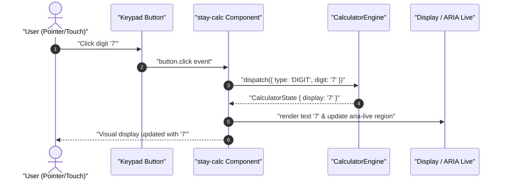
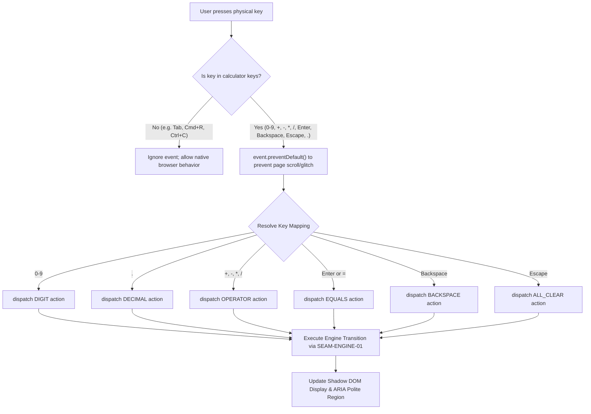
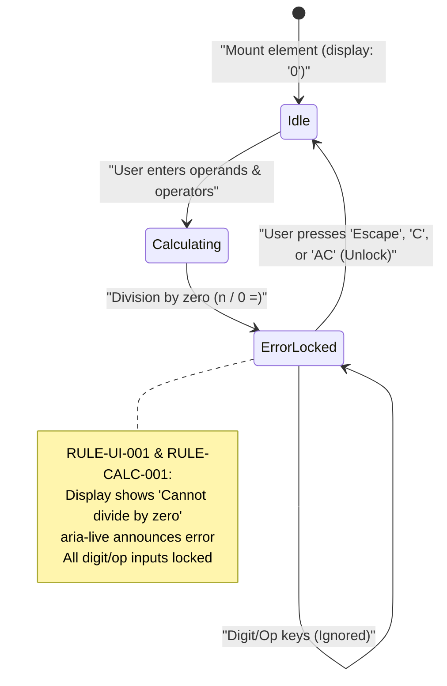

# User Flow: Accessible UI & Keyboard Navigation

Authoritative user interaction logic, event routing, keyboard interception, and visual state transitions for the `<stay-calc>` autonomous custom element.

---

## 1. Flow Overview & Interaction Bounds
- **Goal**: Receive touch, pointer, and physical keyboard inputs, route valid calculator actions into `CalculatorEngine` via `SEAM-ENGINE-01`, update encapsulated display and ARIA live regions, and maintain zero horizontal viewport overflow.
- **Primary Surface**: `<stay-calc>` Autonomous Custom Element (`src/components/stay-calc.ts`)
- **Actor Role**: `GeneralUser`, `KeyboardPowerUser`, `ScreenReaderUser`
- **Entry Trigger**: Button click on Shadow DOM keypad or physical keypress on host/window.
- **Exit Outcome**: Display element updated with current operand, running total, or locked error state (`"Cannot divide by zero"`).
- **Latency & SLA Bounds**: Event interception and DOM re-render completed within `<= 16ms` (60fps tactile feedback).

---

## 2. Entry Points

| Entry ID | Trigger / Source | Preconditions | Initial Surface | Inbound Flow |
| :--- | :--- | :--- | :--- | :--- |
| `ENT-UI-01` | Component registration / mount | DOM attachment (`connectedCallback`) | `SCR-UI-IDLE` | Shadow DOM template instantiated; initial display "0" |
| `ENT-UI-02` | Pointer / touch button click | Button clicked in keypad slot | `SCR-UI-INPUT` | Button dataset mapped to `CalculatorAction` |
| `ENT-UI-03` | Physical keyboard keypress | Keypress detected on window / host | `SCR-UI-INPUT` | Valid key intercepted, mapped to action, default prevented |
| `ENT-UI-04` | Escape or All Clear key | Any state | `SCR-UI-IDLE` | Flushes all registers and unlocks error state |

---

## 3. Canonical Flow Sequences

### Flow A: Interactive Keypad Button Click to Display

### Flow B: Physical Keyboard Interception & Event Routing

### Flow C: Error Lock & Keyboard Recovery Sequence

---

## 4. Decision Points Matrix

| Decision ID | Decision Question | Evaluated At (Screen / Node) | Condition / Input | YES / Branch 1 Path | NO / Branch 2 Path | Failure / Undefined Law |
| :--- | :--- | :--- | :--- | :--- | :--- | :--- |
| `DEC-UI-01` | Is incoming keyboard key recognized as calculator input? | Event Listener | `['0'..'9', '+', '-', '*', '/', 'Enter', '=', 'Backspace', 'Escape', '.'].includes(key)` | Intercept, `preventDefault()`, dispatch action | Let event pass through to browser | `RULE-UI-002` |
| `DEC-UI-02` | Is component currently in error locked state? | State Dispatch | `state.isLocked === true` | Only accept `CLEAR`, `ALL_CLEAR`, or `Escape` | Process standard action | `RULE-CALC-001` |
| `DEC-UI-03` | Are light DOM children slotted into `<slot name="display">`? | Template Mount | `slot.assignedNodes().length > 0` | Reflect display into slotted element | Render default Shadow DOM display | `RULE-UI-001` |
| `DEC-UI-04` | Is container viewport narrower than 390px? | Layout Evaluation | Container / Viewport width <= 390px | Apply compact container query spacing | Apply default desktop spacing | `RULE-RESP-001` |

---

## 5. Recovery Flows & Error Loops

### `REC-UI-01`: Visual Error Lock Recovery
- **Triggering Failure**: Division by zero attempt (`5 / 0 =`).
- **Recovery Surface**: `SCR-UI-ERROR`
- **User Actions Available**:
  1. **Click `C` / `AC` button**: Resets display and unlocks keypad.
  2. **Press `Escape` key**: Resets all registers to `"0"` and unlocks keyboard listeners.
- **Max Retry Bound**: Unlimited retries; component remains locked until explicit unlock key.

---

## 6. Exit Points

| Exit ID | Destination Surface | Final User State | UI Feedback / Notification | Next Available Action |
| :--- | :--- | :--- | :--- | :--- |
| `EXT-UI-01` | `SCR-UI-IDLE` | Result Displayed | Display shows formatted number, live region spoken | Next digit starts fresh calculation; operator chains result |
| `EXT-UI-02` | `SCR-UI-ERROR` | Error Locked | Display shows error text in red/alert styling | Escape or Clear required to unlock |

---

## 7. Screen Flow & Surface Inventory

| Screen ID | Surface Type | Primary Interactive Elements | Inbound Transitions | Outbound Transitions |
| :--- | :--- | :--- | :--- | :--- |
| `SCR-UI-IDLE` | Component Surface | Display ("0"), 19 Keypad buttons | `ENT-UI-01`, `ENT-UI-04` | `SCR-UI-INPUT` |
| `SCR-UI-INPUT` | Component Surface | Display showing operand, Keypad buttons | `ENT-UI-02`, `ENT-UI-03` | `SCR-UI-EVAL`, `SCR-UI-ERROR` |
| `SCR-UI-EVAL` | Component Surface | Display showing calculated total, Keypad buttons | `=` keypress or button click | `SCR-UI-INPUT`, `SCR-UI-IDLE` |
| `SCR-UI-ERROR` | Component Surface | Display showing "Cannot divide by zero", Keypad | Division by zero event | `SCR-UI-IDLE` (via Escape/Clear) |

---

## 8. References
- [Feature Specification](./feature.md)
- [Test Cases](./cases.md)
