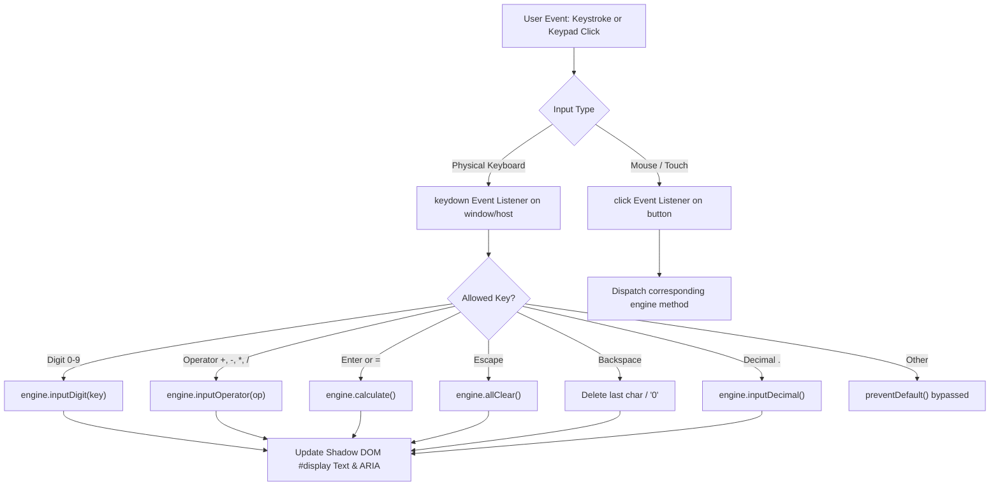

# Logic Flow: Accessible UI & Keyboard Navigation (F2)

## 1. Interaction Architecture

## 2. Decision Tree (`DEC-*`)

- **`DEC-F2-001` (Keyboard Event Binding)**:
  - Attached on `connectedCallback()` and detached cleanly on `disconnectedCallback()` to avoid memory leaks.
- **`DEC-F2-002` (Event Key Normalization)**:
  - Map `x` or `X` to `*` if shift key or numpad used.
  - Map `Enter` to `=` calculation.
  - Prevent default browser scroll when `Space` or `/` (Firefox quick search) is intercepted.
