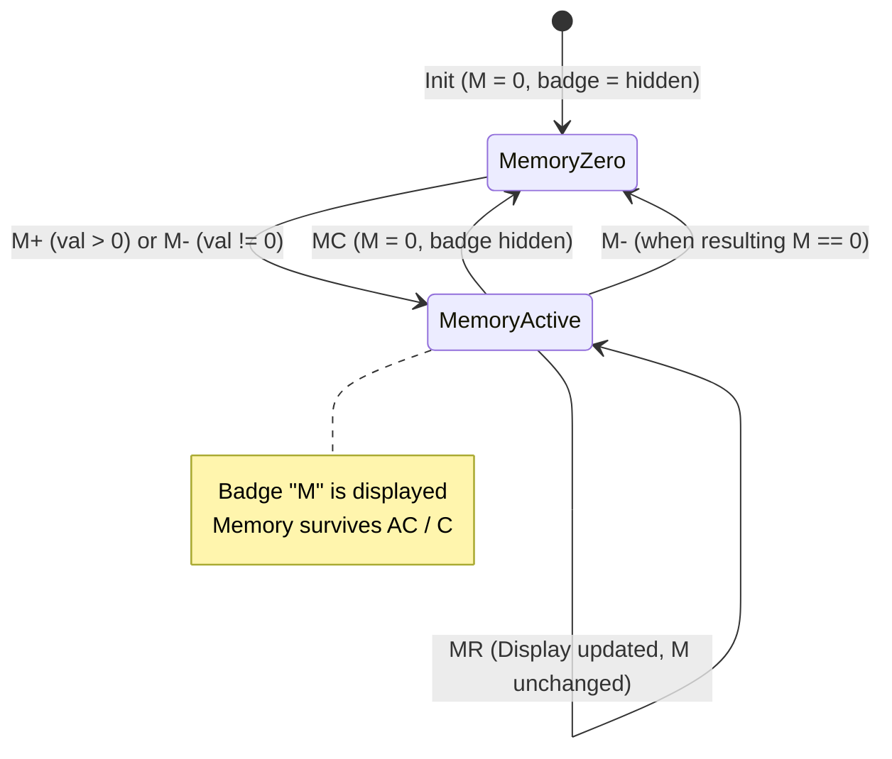

# Logic Flow: Memory Registers (F3)

## 1. State Machine

## 2. Decision Tree (`DEC-*`)

- **`DEC-F3-001` (M+ Trigger)**:
  - If input buffer has valid number, add to accumulator $M$. If $M \ne 0$, show `"M"` badge. Set `waitingForOperand = true`.
- **`DEC-F3-002` (M- Trigger)**:
  - Subtract input buffer from $M$. If $M \ne 0$, show `"M"` badge; if $M = 0$, hide badge. Set `waitingForOperand = true`.
- **`DEC-F3-003` (MR Trigger)**:
  - Load $M$ value into display buffer. Set `waitingForOperand = true`.
- **`DEC-F3-004` (MC Trigger)**:
  - Reset $M = 0$. Hide `"M"` badge immediately.
