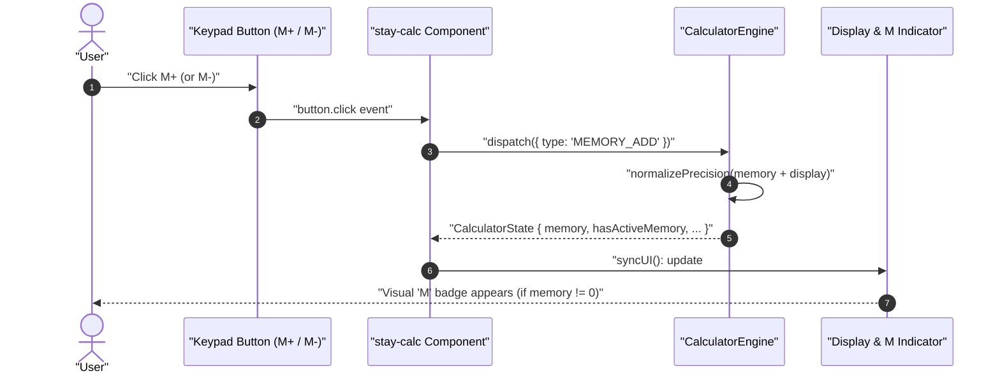
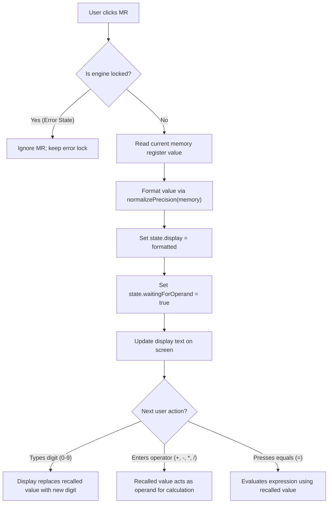
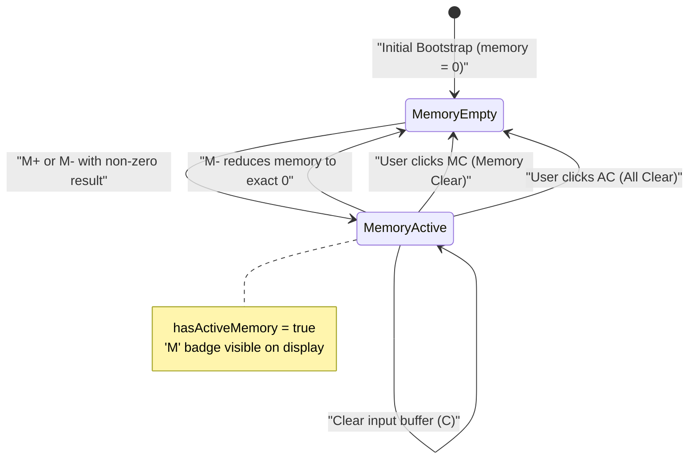

# User Flow: Memory Registers & Active Indicator

Authoritative user interaction logic, memory register transitions, active indicator synchronization, and decision trees for Feature F3.

---

## 1. Flow Overview & Interaction Bounds
- **Goal**: Allow users to store, accumulate, subtract, recall, and clear numeric values in a dedicated memory register, with instantaneous synchronization of the visual "M" badge on the calculator display.
- **Primary Surface**: `<stay-calc>` Keypad & Display (`src/components/stay-calc.ts`), backed by `CalculatorEngine` (`src/engine/calculator-engine.ts`).
- **Actor Role**: `GeneralUser`, `KeyboardPowerUser`, `ScreenReaderUser`
- **Entry Trigger**: User clicks or triggers `M+`, `M-`, `MR`, or `MC`.
- **Exit Outcome**: Memory register updated; "M" badge reflected as visible or hidden; display updated (on `MR`) or retained (on `M+`, `M-`, `MC`).
- **Latency & SLA Bounds**: Memory arithmetic and UI synchronization executed synchronously in `<= 16ms`.

---

## 2. Entry Points

| Entry ID | Trigger / Source | Preconditions | Initial Surface | Inbound Flow |
| :--- | :--- | :--- | :--- | :--- |
| `ENT-MEM-01` | Click `M+` (Memory Add) | Valid display number, engine not locked | `SCR-MEM-READY` | Display value added to memory with float normalization |
| `ENT-MEM-02` | Click `M-` (Memory Subtract) | Valid display number, engine not locked | `SCR-MEM-READY` | Display value subtracted from memory with float normalization |
| `ENT-MEM-03` | Click `MR` (Memory Recall) | Engine not locked | `SCR-MEM-READY` | Formatted memory value recalled into display buffer |
| `ENT-MEM-04` | Click `MC` (Memory Clear) | Engine not locked | `SCR-MEM-READY` | Memory register reset to 0, "M" badge dismissed |
| `ENT-MEM-05` | Click `AC` or press `Escape` | Any engine state | `SCR-MEM-READY` | Complete reset flushes memory to 0 and clears "M" badge |

---

## 3. Canonical Flow Sequences

### Flow A: Memory Accumulation and Indicator Sync (M+ / M-)

### Flow B: Memory Recall into Calculation (MR)

### Flow C: Memory Register State Lifecycle

---

## 4. Decision Points Matrix

| Decision ID | Decision Question | Evaluated At (Screen / Node) | Condition / Input | YES / Branch 1 Path | NO / Branch 2 Path | Failure / Undefined Law |
| :--- | :--- | :--- | :--- | :--- | :--- | :--- |
| `DEC-MEM-01` | Is calculator engine locked in error state? | `CalculatorEngine.dispatch` | `state.isLocked === true` | Reject memory action; retain error lock | Process memory action normally | `NEVER-CALC-004` |
| `DEC-MEM-02` | Does memory register equal zero after operation? | `calculatorReducer` | `cleanMemory === 0` | Set `hasActiveMemory = false`; hide "M" badge | Set `hasActiveMemory = true`; show "M" badge | `RULE-CALC-006` |
| `DEC-MEM-03` | Is clear action Clear (`C`) or All Clear (`AC`)? | `calculatorReducer` | `action.type === 'CLEAR'` | Reset active input buffer only; preserve memory | Reset all registers including memory (`AC`) | `RULE-CALC-009` |
| `DEC-MEM-04` | Does user type a digit following Memory Recall (`MR`)? | `case 'DIGIT'` | `state.waitingForOperand === true` | Replace display with new digit | Append digit to display | Pocket calculator standard |

---

## 5. Error Recovery Paths

| Recovery ID | Stall / Condition | System State Before | Corrective Action | System State After |
| :--- | :--- | :--- | :--- | :--- |
| `REC-MEM-01` | Division by zero occurs while memory has value | `isLocked: true`, `memory: 42` | User presses `C` | `isLocked: false`, `display: '0'`, `memory: 42` preserved (`RULE-CALC-006`) |
| `REC-MEM-02` | Accidental `M+` on wrong value | `memory: 50` (incorrect addition) | User enters value and presses `M-` | Memory corrected to intended value without losing state |
| `REC-MEM-03` | Memory value equals `-0` | `memory: -0` | Precision normalization clamps `-0` to `0` | `memory: 0`, `hasActiveMemory: false`, badge hidden |

---

## 6. Screen & Surface Inventory

| Screen ID | Surface / Container | Active Elements | Visual State & Indicators |
| :--- | :--- | :--- | :--- |
| `SCR-MEM-EMPTY` | `<stay-calc>` Display | `#memoryIndicator`, `#displayValue` | `#memoryIndicator` hidden (`visibility: hidden`, opacity 0) |
| `SCR-MEM-ACTIVE` | `<stay-calc>` Display | `#memoryIndicator`, `#displayValue` | `#memoryIndicator` active and visible (bold blue "M" badge) |
| `SCR-MEM-KEYPAD` | `<stay-calc>` Keypad | `.btn-memory` (`MC`, `MR`, `M-`, `M+`) | Top 4-button memory row with standard token styling |
