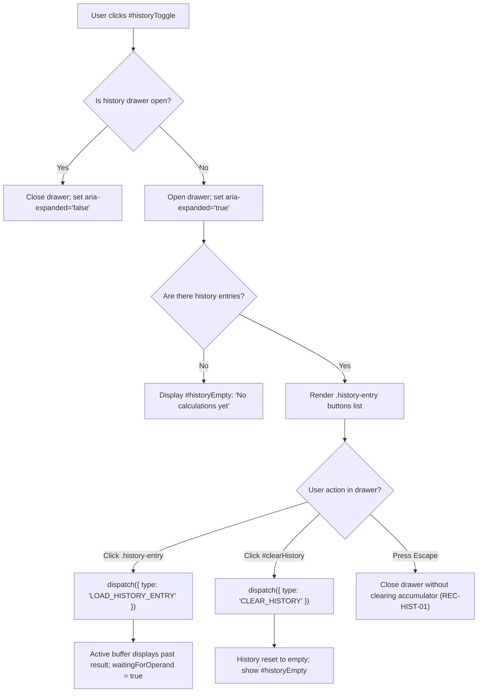

# User Flow: Calculation History Tape & Drawer

Authoritative user interaction logic, history drawer transitions, audit tape recording, and decision trees for Feature F4.

---

## 1. Flow Overview & Interaction Bounds
- **Goal**: Allow users to inspect past calculations in a chronological tape, toggle an accessible slide-out drawer, click any past calculation to recall its result into the active input buffer, clear history explicitly, and dismiss the drawer via keyboard without losing active calculation state.
- **Primary Surface**: `<stay-calc>` Keypad, Header & History Drawer (`src/components/stay-calc.ts`), backed by `CalculatorEngine` (`src/engine/calculator-engine.ts`).
- **Actor Role**: `GeneralUser`, `KeyboardPowerUser`, `ScreenReaderUser`
- **Entry Trigger**: User clicks `#historyToggle` button, clicks a `.history-entry`, clicks `#clearHistory`, or evaluates a formula via `=`.
- **Exit Outcome**: Drawer opened or closed; history recorded or cleared; past result loaded into buffer.
- **Latency & SLA Bounds**: Tape recording and drawer rendering executed synchronously in `<= 16ms`.

---

## 2. Entry Points

| Entry ID | Trigger / Source | Preconditions | Initial Surface | Inbound Flow |
| :--- | :--- | :--- | :--- | :--- |
| `ENT-HIST-01` | Click `=` or press Enter | Valid binary operation pending | `SCR-HIST-CLOSED` | Engine evaluates formula, creates history entry if successful, prepends to tape |
| `ENT-HIST-02` | Click `#historyToggle` | Drawer is closed | `SCR-HIST-CLOSED` | Opens `#historyDrawer`, sets `aria-expanded="true"`, renders entries or empty message |
| `ENT-HIST-03` | Click `#historyToggle` | Drawer is open | `SCR-HIST-OPEN` | Closes `#historyDrawer`, sets `aria-expanded="false"` |
| `ENT-HIST-04` | Click a `.history-entry` | Drawer is open, entries exist | `SCR-HIST-OPEN` | Loads entry result into active display buffer (`waitingForOperand = true`) |
| `ENT-HIST-05` | Click `#clearHistory` | Drawer is open | `SCR-HIST-OPEN` | Flushes all entries from tape, displays `#historyEmpty` message |
| `ENT-HIST-06` | Press `Escape` | Drawer is open | `SCR-HIST-OPEN` | Closes drawer without resetting calculator accumulator or input buffer |

---

## 3. Canonical Flow Sequences

### Flow A: Calculation Evaluation and History Tape Logging

```mermaid
sequenceDiagram
    autonumber
    actor User as "User"
    participant Calc as "stay-calc Component"
    participant Engine as "CalculatorEngine"
    participant Drawer as "History Drawer (#historyDrawer)"

    User->>Calc: "Press Equals (=) or Enter"
    Calc->>Engine: "dispatch({ type: 'EQUALS' })"
    alt Successful Calculation
        Engine->>Engine: "evaluateBinary() -> res.success = true"
        Engine->>Engine: "Prepend CalculationHistoryEntry (cap at 100)"
        Engine-->>Calc: "CalculatorState { display, history, ... }"
        Calc->>Drawer: "Update history list DOM"
        Calc-->>User: "Dispatches 'calc-change' & 'history-change' CustomEvent"
    else Error State (e.g. Division by Zero)
        Engine->>Engine: "res.success = false (Cannot divide by zero)"
        Engine->>Engine: "Do NOT record history entry (RULE-CALC-007)"
        Engine-->>Calc: "CalculatorState { isLocked: true, error, history }"
        Calc-->>User: "Display error message; history unchanged"
    end
```

### Flow B: History Drawer Interaction & Result Reload



---

## 4. Decision Points Matrix

| Decision ID | Decision Question | Evaluated At (Screen / Node) | Condition / Input | YES / Branch 1 Path | NO / Branch 2 Path | Failure / Undefined Law |
| :--- | :--- | :--- | :--- | :--- | :--- | :--- |
| `DEC-HIST-01` | Does calculation result in an error (e.g. division by zero)? | `case 'EQUALS'` | `!res.success` | Exclude from history tape; set error lock | Record new `CalculationHistoryEntry` | `RULE-CALC-007` |
| `DEC-HIST-02` | Does history list exceed 100 entries? | `CalculatorEngine.dispatch` | `newHistory.length > 100` | Prune oldest entries via FIFO slice | Retain all existing entries | `RULE-CALC-005` |
| `DEC-HIST-03` | Does user press Escape while history drawer is open? | `StayCalc.handleKeyDown` | `this.isDrawerOpen === true` | Dismiss drawer only; preserve calculation | Execute normal `ALL_CLEAR` | `RULE-UI-002` |
| `DEC-HIST-04` | Does user click on past history entry item? | `StayCalc.handleHistoryClick` | Valid `.history-entry` clicked | Reload result into display buffer | Ignore click | `SEAM-ENGINE-02` |

---

## 5. Error Recovery Paths

| Recovery ID | Stall / Condition | System State Before | Corrective Action | System State After |
| :--- | :--- | :--- | :--- | :--- |
| `REC-HIST-01` | History drawer opened mid-calculation; user wants to return | In-progress calculation (`accumulator = 10`, `pendingOp = '+'`) | User presses `Escape` | Drawer dismissed; formula and accumulator completely intact (`RULE-UI-002`) |
| `REC-HIST-02` | User accidentally clears active buffer with `C` | Display `"0"`, past calculation completed | User opens drawer and clicks previous entry | Previous calculation result restored to display (`waitingForOperand = true`) |
| `REC-HIST-03` | Continuous heavy calculations (> 100 operations) | 100 entries in tape | New calculation evaluated | Oldest entry automatically pruned; exactly 100 most recent entries kept (`RULE-CALC-005`) |

---

## 6. Screen & Surface Inventory

| Screen ID | Surface / Container | Active Elements | Visual State & Indicators |
| :--- | :--- | :--- | :--- |
| `SCR-HIST-CLOSED` | `<stay-calc>` Host | `#historyToggle`, `#defaultDisplay`, `#defaultKeypad` | Drawer closed (`aria-hidden="true"`), `#historyToggle` has `aria-expanded="false"` |
| `SCR-HIST-OPEN` | `<stay-calc>` Drawer | `#historyDrawer`, `#clearHistory`, `.history-entry` | Drawer open (`aria-hidden="false"`), `#historyToggle` has `aria-expanded="true"`, entries listed |
| `SCR-HIST-EMPTY` | `<stay-calc>` Drawer | `#historyDrawer`, `#historyEmpty` ("No calculations yet") | Drawer open, `#historyEmpty` container visible, zero history items |

---

## 7. References
- [Feature Specification](./feature.md)
- [Test Cases](./cases.md)
