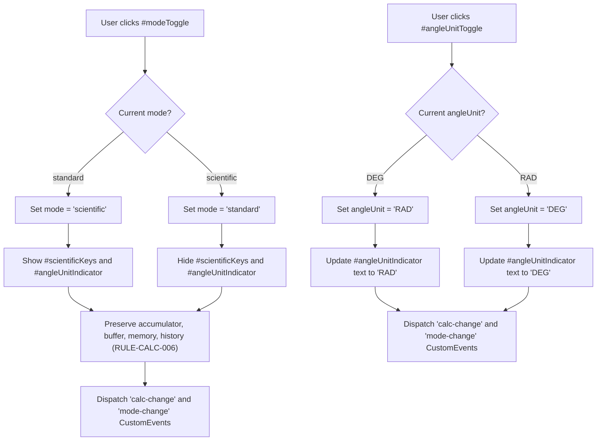

# User Flow: Scientific Mode Toggle and Functions

Authoritative user interaction logic, screen state transitions, decision trees, and error recovery paths for Feature F5 (Scientific Mode).

---

## 1. Flow Overview & Interaction Bounds
- **Goal**: Allow users to toggle between standard and scientific calculation modes without losing work (`RULE-CALC-006`), switch trigonometric angle measurement units between degrees (`DEG`) and radians (`RAD`), load fundamental mathematical constants ($\pi$, $e$), and compute unary ($\sqrt{x}$, $x^2$, $\sin$, $\cos$, $\tan$) and binary ($x^y$) scientific operations.
- **Primary Surface**: `<stay-calc>` Header, Display, Scientific Keys, and Primary Keypad (`src/components/stay-calc.ts`), backed by `CalculatorEngine` (`src/engine/calculator-engine.ts`).
- **Actor Role**: `GeneralUser`, `KeyboardPowerUser`, `ScreenReaderUser`
- **Entry Trigger**: User clicks `#modeToggle`, clicks `#angleUnitToggle`, clicks any button in `#scientificKeys`, or types scientific operators (e.g. `^`).
- **Exit Outcome**: Calculation evaluated, mode updated, angle unit changed, or error state safely entered and unlocked.
- **Latency & SLA Bounds**: Mode toggle and function evaluations execute synchronously in `<= 1ms`.

---

## 2. Entry Points

| Entry ID | Trigger / Source | Preconditions | Initial Surface | Inbound Flow |
| :--- | :--- | :--- | :--- | :--- |
| `ENT-SCI-01` | Click `#modeToggle` | Calculator mounted in standard mode | `SCR-STD-MODE` | Switches to scientific mode, expands `#scientificKeys`, preserves buffer (`RULE-CALC-006`) |
| `ENT-SCI-02` | Click `#modeToggle` | Calculator mounted in scientific mode | `SCR-SCI-MODE` | Switches to standard mode, hides `#scientificKeys`, preserves buffer (`RULE-CALC-006`) |
| `ENT-SCI-03` | Click `#angleUnitToggle` | Scientific mode active | `SCR-SCI-MODE` | Toggles unit between `DEG` and `RAD`, updates `#angleUnitIndicator` |
| `ENT-SCI-04` | Click scientific unary key (`√`, `x²`, `sin`, `cos`, `tan`) | Scientific mode active | `SCR-SCI-MODE` | Executes immediate unary calculation on current buffer |
| `ENT-SCI-05` | Click constant key (`π`, `e`) | Scientific mode active | `SCR-SCI-MODE` | Loads constant value into buffer (`waitingForOperand = true`) |
| `ENT-SCI-06` | Click power key (`xʸ`) or press `^` | Any mode / Scientific mode | `SCR-SCI-MODE` | Registers `^` operator, prepares for exponent entry |

---

## 3. Canonical Flow Sequences

### Flow A: Scientific Mode Toggling & Angle Unit Switching



### Flow B: Scientific Function Evaluation and Domain Protection

```mermaid
sequenceDiagram
    autonumber
    actor User as "User"
    participant Calc as "stay-calc Component"
    participant Engine as "CalculatorEngine"

    User->>Calc: "Click scientific function (e.g. √, sin, xʸ)"
    Calc->>Engine: "dispatch(action)"
    alt Valid Mathematical Domain
        Engine->>Engine: "Evaluate with precision normalization"
        Engine-->>Calc: "CalculatorState { display: formatted, isLocked: false }"
        Calc-->>User: "Display formatted result; waitingForOperand = true"
    else Invalid Input (e.g. √(-4), tan(90°) in DEG)
        Engine->>Engine: "Domain violation detected"
        Engine-->>Calc: "CalculatorState { display: 'Invalid input', isLocked: true }"
        Calc-->>User: "Display 'Invalid input' with error styling; input locked"
    end
```

---

## 4. Decision Points Matrix

| Decision ID | Decision Question | Evaluated At (Screen / Node) | Condition / Input | YES / Branch 1 Path | NO / Branch 2 Path | Failure / Undefined Law |
| :--- | :--- | :--- | :--- | :--- | :--- | :--- |
| `DEC-SCI-01` | What is target mode upon `#modeToggle`? | `SCR-STD-MODE` / `SCR-SCI-MODE` | `state.mode === 'standard'` | Transition to `scientific` | Transition to `standard` | `RULE-CALC-006` |
| `DEC-SCI-02` | What is target angle unit upon `#angleUnitToggle`? | `SCR-ANGLE-DEG` / `SCR-ANGLE-RAD` | `state.angleUnit === 'DEG'` | Transition to `RAD` | Transition to `DEG` | `RULE-CALC-003` |
| `DEC-SCI-03` | Does unary operation violate domain bounds? | Scientific key click | Value $< 0$ for $\sqrt{x}$ or $90^\circ$ for $\tan$ in DEG | Enter locked error state (`"Invalid input"`) | Compute normalized result | `RULE-CALC-001`, `NEVER-CALC-004` |
| `DEC-SCI-04` | Is power operator `^` entered after existing operator? | `case 'OPERATOR'` | `state.waitingForOperand && state.pendingOperator !== null` | Replace pending operator with `^` | Standard binary evaluation | `RULE-CALC-008` |

---

## 5. Error Recovery Paths

| Recovery ID | Stall / Condition | System State Before | Corrective Action | System State After |
| :--- | :--- | :--- | :--- | :--- |
| `REC-SCI-01` | Domain violation lockout (`"Invalid input"`) | `display: "Invalid input"`, `isLocked: true` | User clicks `C` or `AC` | Engine unlocked, display `"0"`, mode & angle preserved |
| `REC-SCI-02` | Mode toggled mid-calculation | In-progress calculation (`10 +` pending) | User clicks `#modeToggle` | Mode toggles; accumulator `10` and pending `+` fully intact (`RULE-CALC-006`) |
| `REC-SCI-03` | Evaluation in wrong angle unit | Trigonometric result evaluated in unexpected unit | User clicks `#angleUnitToggle`, re-enters value | New calculation executed in desired angle unit (`DEG` or `RAD`) |

---

## 6. Screen & Surface Inventory

| Screen ID | Surface / Container | Active Elements | Visual State & Indicators |
| :--- | :--- | :--- | :--- |
| `SCR-STD-MODE` | `<stay-calc>` Host | `#modeToggle`, `#defaultDisplay`, `#defaultKeypad` | Standard 4-function layout; `#scientificKeys` hidden; `#modeToggle` shows "Scientific" |
| `SCR-SCI-MODE` | `<stay-calc>` Host | `#modeToggle`, `#angleUnitToggle`, `#scientificKeys`, `#defaultKeypad` | Scientific layout; `#scientificKeys` visible; `#modeToggle` shows "Standard" |
| `SCR-ANGLE-DEG` | `<stay-calc>` Header / Display | `#angleUnitIndicator` ("DEG"), `#angleUnitToggle` | Degree unit active; badge displays "DEG" |
| `SCR-ANGLE-RAD` | `<stay-calc>` Header / Display | `#angleUnitIndicator` ("RAD"), `#angleUnitToggle` | Radian unit active; badge displays "RAD" |

---

## 7. References
- [Feature Specification](./feature.md)
- [Test Cases](./cases.md)
