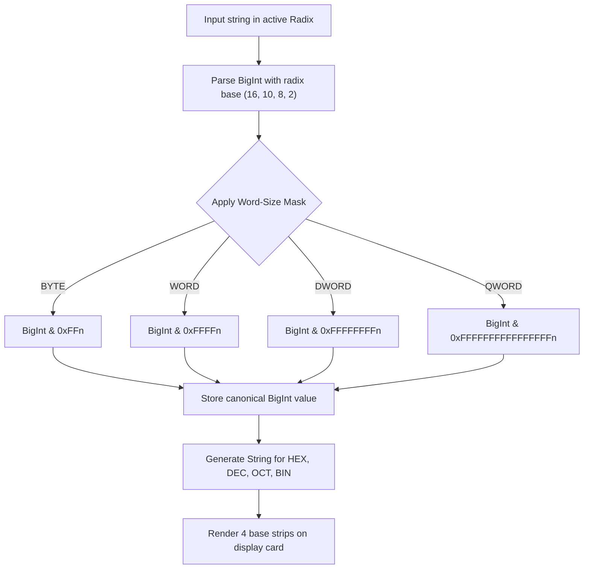

# Logic Flow: Programmer Radix Mode (F6)

## 1. Execution Pipeline

## 2. Decision Tree (`DEC-*`)

- **`DEC-F6-001` (Radix Selection)**:
  - User switches active radix (e.g. from DEC to HEX). Digits on keypad adjust (A-F enabled in HEX, 2-9 disabled in BIN, 8-9 disabled in OCT).
- **`DEC-F6-002` (Word Size Clamping)**:
  - Switching word size (e.g. from DWORD to BYTE) immediately clamps existing value via `val & 0xFFn`.
- **`DEC-F6-003` (Bitwise Operations)**:
  - Binary bitwise operations execute sequentially with immediate clamping.
