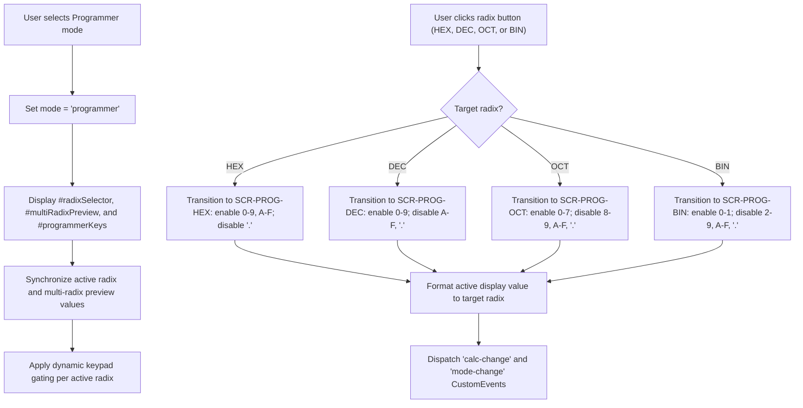

# User Flow: Programmer Radix Mode and Bitwise Operations

Authoritative user interaction logic, screen state transitions, decision trees, and error recovery paths for Feature F6 (Programmer Radix Mode and Bitwise Operations).

---

## 1. Flow Overview & Interaction Bounds
- **Goal**: Allow developers and engineers to switch to programmer mode, select between four positional numeral systems (`HEX`, `DEC`, `OCT`, `BIN`), view simultaneous multi-radix preview values, input valid digits under dynamic keypad gating, execute 32-bit signed bitwise operations (`AND`, `OR`, `XOR`, `NOT`, `LSH`, `RSH`), and perform integer arithmetic without losing memory, history, or intermediate accumulators (`RULE-CALC-006`).
- **Primary Surface**: `<stay-calc>` Header, Multi-Radix Preview Panel (`#multiRadixPreview`), Radix Selector (`#radixSelector`), Programmer Keys (`#programmerKeys`), Display, and Primary Keypad (`src/components/stay-calc.ts`), backed by `CalculatorEngine` (`src/engine/calculator-engine.ts`).
- **Actor Role**: `ProgrammerUser`, `KeyboardPowerUser`, `ScreenReaderUser`
- **Entry Trigger**: User switches mode to `"programmer"`, clicks any radix button (`HEX`, `DEC`, `OCT`, `BIN`), inputs hex/bin digits, or presses bitwise operation keys.
- **Exit Outcome**: Calculation evaluated, radix converted, multi-radix preview synchronized, or error state safely entered and unlocked.
- **Latency & SLA Bounds**: Radix switching and bitwise evaluations execute synchronously in `<= 1ms`.

---

## 2. Entry Points

| Entry ID | Trigger / Source | Preconditions | Initial Surface | Inbound Flow |
| :--- | :--- | :--- | :--- | :--- |
| `ENT-PROG-01` | Switch mode to programmer | Calculator mounted in standard or scientific mode | `SCR-STD-MODE` / `SCR-SCI-MODE` | Switches to programmer mode, renders `#radixSelector`, `#multiRadixPreview`, `#programmerKeys` |
| `ENT-PROG-02` | Click Radix button (`HEX`, `DEC`, `OCT`, `BIN`) | Programmer mode active | `SCR-PROG-*` | Converts display to selected radix, applies dynamic keypad gating, updates `#multiRadixPreview` |
| `ENT-PROG-03` | Click Hex digit key (`A`–`F`) or type hex key | Programmer mode active with `radix === 'HEX'` | `SCR-PROG-HEX` | Appends hex digit to active buffer, updates all multi-radix preview cards |
| `ENT-PROG-04` | Click Bitwise binary key (`AND`, `OR`, `XOR`, `LSH`, `RSH`) | Programmer mode active | `SCR-PROG-*` | Registers bitwise operator, prepares for second operand |
| `ENT-PROG-05` | Click Bitwise unary key (`NOT` / `~`) | Programmer mode active | `SCR-PROG-*` | Computes immediate 32-bit signed bitwise NOT (`~x`) on active buffer |
| `ENT-PROG-06` | Click integer arithmetic operator (`+`, `-`, `*`, `/`) | Programmer mode active | `SCR-PROG-*` | Performs 32-bit integer arithmetic with division-by-zero protection |

---

## 3. Canonical Flow Sequences

### Flow A: Programmer Mode Transition and Radix Switching



### Flow B: Bitwise Operation Evaluation and Division-by-Zero Safeguard

```mermaid
sequenceDiagram
    autonumber
    actor User as "User"
    participant Calc as "stay-calc Component"
    participant Engine as "CalculatorEngine"

    User->>Calc: "Click bitwise operation (e.g. AND, OR, XOR, LSH, RSH)"
    Calc->>Engine: "dispatch(action)"
    alt Bitwise binary operation
        Engine->>Engine: "Register operator; preserve 32-bit accumulator"
        Engine-->>Calc: "CalculatorState { waitingForOperand: true }"
        Calc-->>User: "Awaiting next operand; keypad gated to active radix"
    else Integer Division by Zero
        Calc->>Engine: "dispatch({ type: 'OPERATOR', operator: '/' }) followed by 0, '='"
        Engine->>Engine: "Detect divisor === 0"
        Engine-->>Calc: "CalculatorState { display: 'Cannot divide by zero', isLocked: true }"
        Calc-->>User: "Display error styling; lock keypad; unlock on C / AC / Escape"
    end
```

---

## 4. Decision Points Matrix

| Decision ID | Decision Question | Evaluated At (Screen / Node) | Condition / Input | YES / Branch 1 Path | NO / Branch 2 Path | Failure / Undefined Law |
| :--- | :--- | :--- | :--- | :--- | :--- | :--- |
| `DEC-PROG-01` | What is target radix upon selection? | Radix Selector | `action.radix` (`HEX`, `DEC`, `OCT`, `BIN`) | Set `state.radix`, convert display value | Maintain current radix | `RULE-CALC-004` |
| `DEC-PROG-02` | Is keypad digit allowed in active radix? | Keypad click / Keydown | Character matches active radix alphabet | Append digit to active buffer | Reject / Ignore input | `RULE-CALC-004` |
| `DEC-PROG-03` | Is integer divisor zero? | `case 'EQUALS'` or `case 'OPERATOR'` | `pendingOperator === '/' && currentVal === 0` | Trigger `"Cannot divide by zero"`, set `isLocked = true` | Evaluate integer division `(acc / curr) \| 0` | `RULE-CALC-001`, `NEVER-CALC-004` |
| `DEC-PROG-04` | Is bitwise operator entered after existing operator? | `case 'OPERATOR'` | `state.waitingForOperand && state.pendingOperator !== null` | Replace pending operator with new bitwise operator | Register first operand | `RULE-CALC-008` |

---

## 5. Error Recovery Paths

| Recovery ID | Stall / Condition | System State Before | Corrective Action | System State After |
| :--- | :--- | :--- | :--- | :--- |
| `REC-PROG-01` | Integer division by zero lockout (`"Cannot divide by zero"`) | `display: "Cannot divide by zero"`, `isLocked: true` | User clicks `C` or `AC` or presses `Escape` | Engine unlocked, display `"0"`, radix and mode preserved |
| `REC-PROG-02` | Radix changed mid-calculation | In-progress calculation (`255 AND` pending) | User selects new radix (`BIN`) | Radix switches to `BIN`; accumulator `255` and operator `AND` preserved |
| `REC-PROG-03` | Mode toggled mid-calculation | In-progress calculation (`42 +` pending) | User toggles mode (Programmer <-> Standard) | Mode toggles; accumulator `42`, memory, and history preserved (`RULE-CALC-006`) |

---

## 6. Screen & Surface Inventory

| Screen ID | Surface / Container | Active Elements | Visual State & Indicators |
| :--- | :--- | :--- | :--- |
| `SCR-PROG-HEX` | `<stay-calc>` Host | `#radixSelector` (HEX active), `#multiRadixPreview`, `#programmerKeys` | Hexadecimal radix active; keys 0–9, A–F enabled; `.` disabled |
| `SCR-PROG-DEC` | `<stay-calc>` Host | `#radixSelector` (DEC active), `#multiRadixPreview`, `#programmerKeys` | Decimal radix active; keys 0–9 enabled; A–F, `.` disabled |
| `SCR-PROG-OCT` | `<stay-calc>` Host | `#radixSelector` (OCT active), `#multiRadixPreview`, `#programmerKeys` | Octal radix active; keys 0–7 enabled; 8–9, A–F, `.` disabled |
| `SCR-PROG-BIN` | `<stay-calc>` Host | `#radixSelector` (BIN active), `#multiRadixPreview`, `#programmerKeys` | Binary radix active; keys 0–1 enabled; 2–9, A–F, `.` disabled |

---

## 7. References
- [Feature Specification](./feature.md)
- [Test Cases](./cases.md)
