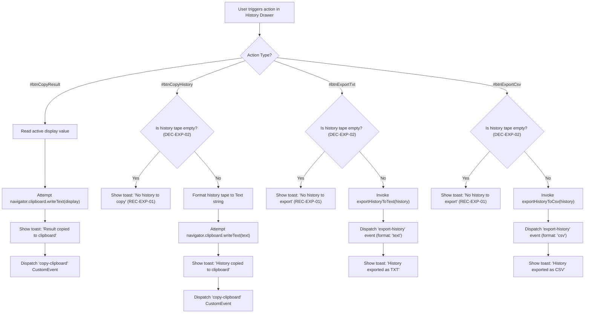

# User Flow: History Tape Export and Clipboard Copy

Authoritative user interaction logic, history drawer action controls, clipboard copy workflows, export formatting paths, and toast notification lifecycles for Feature F7.

---

## 1. Flow Overview & Interaction Bounds
- **Goal**: Allow users to copy active calculation results to clipboard, copy full calculation history tape to clipboard, export history tape as Plain Text or CSV, receive accessible auto-dismissing feedback via toast notifications, and gracefully handle empty history or unavailable clipboard environments without application disruption.
- **Primary Surface**: `<stay-calc>` History Drawer Actions Bar (`#btnCopyResult`, `#btnCopyHistory`, `#btnExportTxt`, `#btnExportCsv`), Drawer Body, and Toast Notification Container (`#toastNotification`), backed by `CalculatorEngine` export formatters (`src/engine/calculator-engine.ts`).
- **Actor Role**: `GeneralUser`, `SpreadsheetAnalyst`, `KeyboardPowerUser`, `ScreenReaderUser`
- **Entry Trigger**: User clicks `#btnCopyResult`, `#btnCopyHistory`, `#btnExportTxt`, or `#btnExportCsv`.
- **Exit Outcome**: Data copied to clipboard; export payload created and event dispatched; toast notification displayed and auto-dismissed.
- **Latency & SLA Bounds**: Export formatting executed synchronously in `<= 2ms`; toast display update `<= 16ms`.

---

## 2. Entry Points

| Entry ID | Trigger / Source | Preconditions | Initial Surface | Inbound Flow |
| :--- | :--- | :--- | :--- | :--- |
| `ENT-EXP-01` | Click `#btnCopyResult` | Calculator mounted with active display | `SCR-HIST-OPEN` | Reads active display, attempts clipboard write, shows feedback toast, dispatches `copy-clipboard` |
| `ENT-EXP-02` | Click `#btnCopyHistory` | Drawer is open | `SCR-HIST-OPEN` | Checks if history empty; formats text tape; copies to clipboard; shows toast; dispatches event |
| `ENT-EXP-03` | Click `#btnExportTxt` | Drawer is open | `SCR-HIST-OPEN` | Checks if history empty; generates text export; dispatches `export-history`; shows toast |
| `ENT-EXP-04` | Click `#btnExportCsv` | Drawer is open | `SCR-HIST-OPEN` | Checks if history empty; generates CSV export; dispatches `export-history`; shows toast |

---

## 3. Canonical Flow Sequences

### Flow A: History Export and Clipboard Copy Workflow



### Flow B: Toast Notification Lifecycle & Debounce Reset

```mermaid
sequenceDiagram
    autonumber
    actor User as "User"
    participant Calc as "stay-calc Component"
    participant Toast as "#toastNotification"
    participant Timer as "Debounce Timer"

    User->>Calc: "Trigger action (e.g. Copy Result)"
    Calc->>Calc: "showToast(message, 2000)"
    alt Timer Active (Rapid Click)
        Calc->>Timer: "clearTimeout(activeTimer)"
    end
    Calc->>Toast: "Set textContent = message; transition to SCR-TOAST-ACTIVE"
    Calc->>Timer: "setTimeout(dismiss, 2000)"
    Note over Toast: "Screen reader announces via aria-live='polite'"
    Timer-->>Calc: "2000ms duration elapses"
    Calc->>Toast: "Clear message; transition to SCR-TOAST-IDLE"
```

---

## 4. Decision Points Matrix

| Decision ID | Decision Question | Evaluated At (Screen / Node) | Condition / Input | YES / Branch 1 Path | NO / Branch 2 Path | Failure / Undefined Law |
| :--- | :--- | :--- | :--- | :--- | :--- | :--- |
| `DEC-EXP-01` | Which export format is requested? | `exportHistory(format)` | `format === 'csv'` | Invoke `exportHistoryToCsv` | Invoke `exportHistoryToText` | Default to `'text'` |
| `DEC-EXP-02` | Is calculation history empty? | Action handlers | `history.length === 0` | Display empty feedback toast (`"No history to copy"` / `"No history to export"`) | Proceed with export or clipboard formatting | `RULE-UI-002` |
| `DEC-EXP-03` | Is Clipboard API supported and granted? | `copyToClipboard()` | `navigator.clipboard?.writeText` resolves | Mark `success: true`; show success toast | Handle rejection gracefully (`success: false`); do not throw (`REC-EXP-02`) | Graceful degradation |
| `DEC-EXP-04` | Is active result or full history requested for copy? | Drawer click / Method | `action === 'copy-result'` | Copy active display value | Copy full plain text formatted tape | `RULE-UI-002` |

---

## 5. Error Recovery Paths

| Recovery ID | Stall / Condition | System State Before | Corrective Action | System State After |
| :--- | :--- | :--- | :--- | :--- |
| `REC-EXP-01` | User clicks copy or export button when history is empty | Empty history tape (`history = []`) | Intercept click; show polite toast `"No history to copy"` or `"No history to export"` | UI stays stable; zero runtime exceptions; toast auto-dismisses |
| `REC-EXP-02` | Browser Clipboard API unavailable or permission denied | Clipboard write rejected or `navigator.clipboard` undefined | Catch rejection in async wrapper; dispatch `copy-clipboard` with `success: false`; do not throw | Component remains responsive; no unhandled promise rejections |
| `REC-EXP-03` | Rapid successive clicks on copy/export buttons | Toast currently visible with active timer | Clear existing timeout; reset text and start fresh 2000ms countdown | Toast displays latest message seamlessly without visual flicker |

---

## 6. Screen & Surface Inventory

| Screen ID | Surface / Container | Active Elements | Visual State & Indicators |
| :--- | :--- | :--- | :--- |
| `SCR-HIST-OPEN` | `<stay-calc>` Drawer | `#historyDrawer`, `#btnCopyResult`, `#btnCopyHistory`, `#btnExportTxt`, `#btnExportCsv`, `#clearHistory` | History drawer open; action toolbar buttons visible and interactive |
| `SCR-HIST-CLOSED` | `<stay-calc>` Host | `#historyToggle`, display, primary keypad | Drawer closed (`aria-hidden="true"`); history toolbar not visible |
| `SCR-TOAST-ACTIVE` | `<stay-calc>` Host | `#toastNotification` | Toast message visible; `role="status"`, `aria-live="polite"`; auto-dismiss timer running |
| `SCR-TOAST-IDLE` | `<stay-calc>` Host | `#toastNotification` | Toast message empty / hidden; awaiting next notification |

---

## 7. References
- [Feature Specification](./feature.md)
- [Test Cases](./cases.md)
