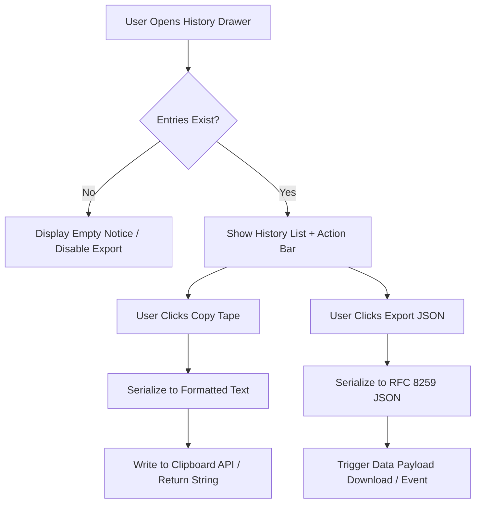

# User Flow: Calculation Tape Export (F7)

## 1. Flow Diagram

## 2. Interaction States
- **SCR-EXP-01 (Drawer Action Bar)**: Top bar of history drawer houses `Copy`, `JSON`, and `Clear` buttons.
- **DEC-EXP-01 (Clipboard Availability)**: If `navigator.clipboard` is available and active document is focused, copy async; else emit or return string payload safely.
- **REC-EXP-01 (Empty State Guard)**: When tape is empty, copy action notifies "Tape is empty" without clipboard mutation.
