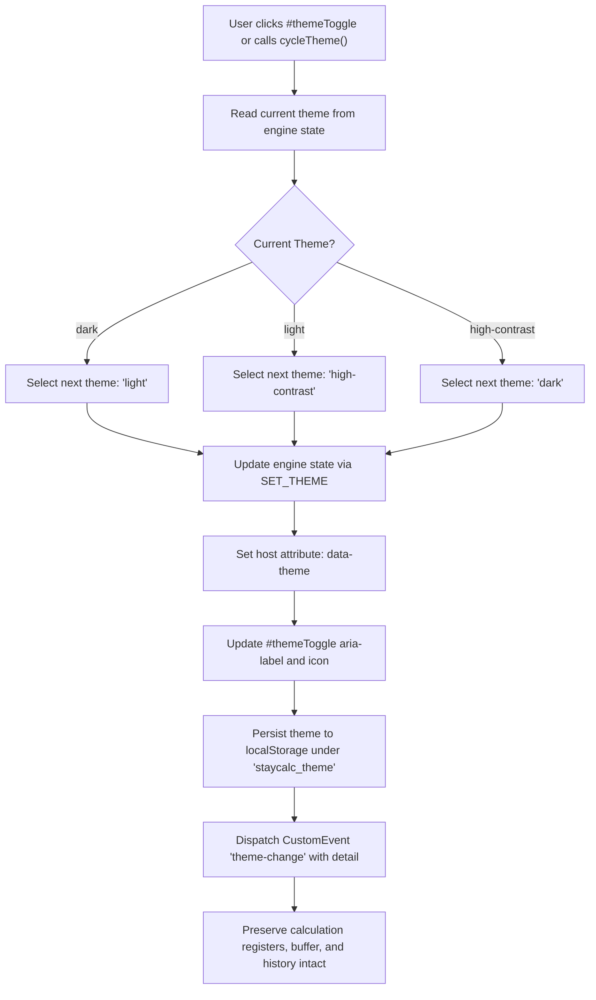

# User Flow: Dynamic Visual Theme Switcher

Authoritative user interaction logic, theme transitions, header button controls, localStorage persistence, and custom event lifecycles for Feature F8.

---

## 1. Flow Overview & Interaction Bounds
- **Goal**: Enable users to dynamically cycle the visual theme between Dark (default), Light, and High-Contrast modes at any time, preserving all active calculations, memory registers, and history, while persisting user preference to `localStorage` and meeting WCAG 2.2 AAA accessibility standards.
- **Primary Surface**: `<stay-calc>` Header Controls (`#themeToggle`), Host Element (`:host`, `:host([data-theme="light"])`, `:host([data-theme="high-contrast"])`), and `CalculatorEngine` state (`src/engine/calculator-engine.ts`).
- **Actor Role**: `GeneralUser`, `LowVisionUser`, `KeyboardPowerUser`, `ScreenReaderUser`
- **Entry Trigger**: Component mount (`connectedCallback`), user clicks `#themeToggle` button, or programmatic `setTheme()` / `cycleTheme()`.
- **Exit Outcome**: Host attribute `data-theme` updated; semantic design tokens activated; `localStorage` updated; `theme-change` CustomEvent dispatched; calculation state preserved.
- **Latency & SLA Bounds**: Theme transition and CSS token recalculation executed synchronously in `<= 16ms` (1 animation frame).

---

## 2. Entry Points

| Entry ID | Trigger / Source | Preconditions | Initial Surface | Inbound Flow |
| :--- | :--- | :--- | :--- | :--- |
| `ENT-THM-01` | Component Mount | `<stay-calc>` added to DOM | `SCR-THEME-DARK` | Reads `localStorage['staycalc_theme']`; applies saved theme if valid; defaults to `'dark'` |
| `ENT-THM-02` | Click `#themeToggle` | Calculator mounted and active | Current screen state | Cycles to next theme (`dark -> light -> high-contrast -> dark`); persists and notifies |
| `ENT-THM-03` | Programmatic API Call | Component reference available | Any screen state | Direct invocation of `setTheme(theme)` or `cycleTheme()` on component instance |

---

## 3. Screen States & Visual Presentations

| Screen ID | Theme Mode | Host Attribute | Primary Palette & Tokens | Border & Contrast Characteristics |
| :--- | :--- | :--- | :--- | :--- |
| `SCR-THEME-DARK` | Dark (Default) | `:host` or `[data-theme="dark"]` | `--calc-bg: #18181b`, `--calc-surface: #27272a`, `--calc-text: #f4f4f5` | Standard 1px solid border (`#3f3f46`), WCAG AA contrast |
| `SCR-THEME-LIGHT` | Light | `[data-theme="light"]` | `--calc-bg: #ffffff`, `--calc-surface: #f4f4f5`, `--calc-text: #09090b` | Standard 1px solid border (`#e4e4e7`), WCAG AA contrast |
| `SCR-THEME-HIGH-CONTRAST` | High-Contrast | `[data-theme="high-contrast"]` | `--calc-bg: #000000`, `--calc-surface: #000000`, `--calc-text: #ffffff` | Prominent 2px solid `#ffffff` borders, WCAG AAA 21:1 contrast |

---

## 4. Canonical Flow Sequences

### Flow A: Theme Cycling & Persistence Sequence

---

## 5. Decision Trees

- **`DEC-THM-01` (Mount Hydration & LocalStorage Discovery)**:
  - On `connectedCallback`, inspect `localStorage.getItem('staycalc_theme')`.
  - If value equals `'dark'`, `'light'`, or `'high-contrast'`, initialize engine and host to that theme.
  - If value is `null`, empty, or unrecognized, initialize engine and host to `'dark'` default.
- **`DEC-THM-02` (Theme Cycle Ordering)**:
  - Current `'dark'` -> Next `'light'`.
  - Current `'light'` -> Next `'high-contrast'`.
  - Current `'high-contrast'` (or any undefined fallback) -> Next `'dark'`.
- **`DEC-THM-03` (Target Theme Validation)**:
  - When `setTheme(theme)` is called with a specific string:
    - If `theme` is `'dark'`, `'light'`, or `'high-contrast'`, transition immediately.
    - If `theme` is invalid or empty, reject mutation or default safely to `'dark'`.
- **`DEC-THM-04` (State Preservation Invariant Check)**:
  - Before and after theme transition, assert `accumulator`, `pendingOperator`, `memory`, `history`, `mode`, `radix`, and active buffer are byte-for-byte identical (`NEVER-CALC-002`).

---

## 6. Error Recovery Paths

- **`REC-THM-01` (LocalStorage Permission Denial or Storage Quota Exceeded)**:
  - Trigger: Browser in private browsing mode, cookies disabled, or `SecurityError` thrown on `localStorage` access.
  - Recovery: Wrap all `localStorage` reads and writes in `try / catch` blocks. When an error is caught, continue in-memory theme execution without crashing or blocking user interactions.
- **`REC-THM-02` (Corrupted Stored Theme Value)**:
  - Trigger: External script or user tampering stores non-theme string (e.g., `'neon'`, `'invalid'`) in `'staycalc_theme'`.
  - Recovery: Component validation discards unverified string, cleans or overwrites invalid entry, and initializes safely in `'dark'` mode.
- **`REC-THM-03` (Theme Switch During Error Lockout)**:
  - Trigger: User clicks `#themeToggle` while display shows `"Cannot divide by zero"` and calculator is locked.
  - Recovery: Engine reducer updates `theme` property while strictly preserving `isLocked: true`, `error: state.error`, and `display: state.display`. Input remains locked until user presses `C` or `AC` (`RULE-CALC-001`).

---

## 7. Exit Points

| Exit ID | Destination | Verification Check |
| :--- | :--- | :--- |
| `EXT-THM-01` | Theme switched successfully | `getTheme()` reflects new theme; host has matching `data-theme`; event dispatched |
| `EXT-THM-02` | LocalStorage updated | `localStorage.getItem('staycalc_theme')` contains serialized theme |
| `EXT-THM-03` | State intact | Display text, memory register, and history tape match pre-switch state exactly |
