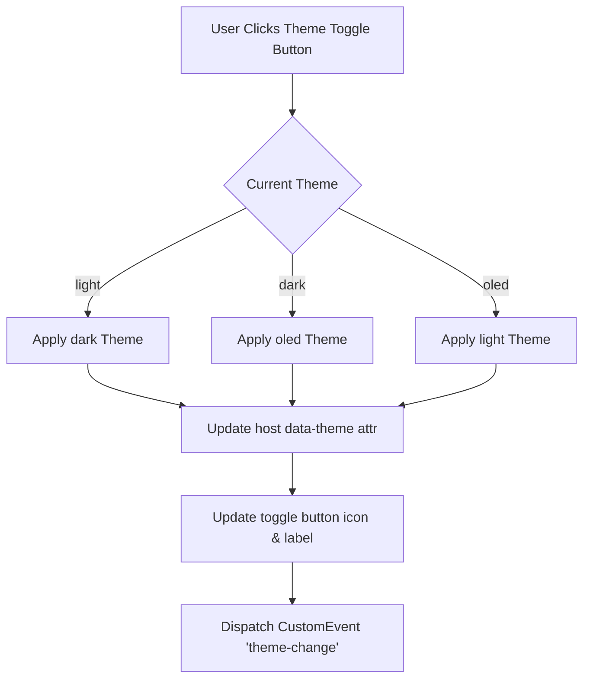

# User Flow: Theme Switcher (F8)

## 1. Flow Diagram

## 2. Interaction States
- **SCR-THM-01 (Header Theme Toggle Button)**: Header displays button `#btn-toggle-theme` showing active icon (`☀️ Light`, `🌙 Dark`, `⚡ OLED`).
- **DEC-THM-01 (Direct API Selection)**: Calling `setTheme(theme)` validates input and transitions immediately.
- **REC-THM-01 (Fallback)**: Unknown theme value resets cleanly to `light`.
