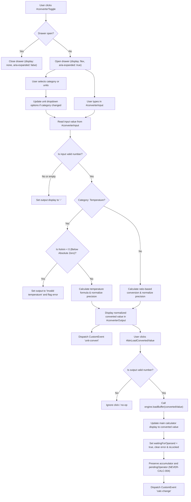

# User Flow: Multi-Unit Converter Extension

Authoritative user interaction logic, drawer transitions, category and unit selection, real-time conversion calculations, and buffer loading for Feature F9.

---

## 1. Flow Overview & Interaction Bounds
- **Goal**: Enable users to quickly convert values between physical measurement units (Length, Mass, Temperature) in an accessible drawer, preview real-time results, and optionally load converted values directly into the calculator's active operand buffer without disrupting in-flight operations or memory registers.
- **Primary Surface**: `<stay-calc>` Header Controls (`#converterToggle`), Collapsible Drawer (`#converterDrawer`), Drawer Controls (`#converterCategory`, `#converterSourceUnit`, `#converterTargetUnit`, `#converterInput`, `#converterOutput`, `#btnLoadConvertedValue`), and `CalculatorEngine` state (`src/engine/calculator-engine.ts`).
- **Actor Role**: `GeneralUser`, `EngineerUser`, `KeyboardPowerUser`, `ScreenReaderUser`
- **Entry Trigger**: User clicks `#converterToggle` button or activates it via keyboard (`Space` or `Enter`).
- **Exit Outcome**: Unit converted; `#converterOutput` updated; `unit-convert` CustomEvent dispatched; value optionally loaded into calculator display via `#btnLoadConvertedValue` with `calc-change` CustomEvent dispatched; calculation state preserved.
- **Latency & SLA Bounds**: Conversion calculations and drawer DOM transitions executed synchronously in `<= 16ms` (1 animation frame).

---

## 2. Entry Points

| Entry ID | Trigger / Source | Preconditions | Initial Surface | Inbound Flow |
| :--- | :--- | :--- | :--- | :--- |
| `ENT-CONV-01` | Click `#converterToggle` | Calculator mounted | Header toolbar | Toggles drawer visibility (`SCR-CONV-CLOSED` <-> `SCR-CONV-OPEN`); updates `aria-expanded` |
| `ENT-CONV-02` | Change Category / Units | Drawer open (`SCR-CONV-OPEN`) | `#converterCategory` / `#converterSourceUnit` / `#converterTargetUnit` | Re-evaluates active conversion; updates unit options and output |
| `ENT-CONV-03` | Type in `#converterInput` | Drawer open (`SCR-CONV-OPEN`) | `#converterInput` | Evaluates conversion live on `input` event; updates `#converterOutput` and dispatches `unit-convert` |
| `ENT-CONV-04` | Click `#btnLoadConvertedValue` | Converted result valid | `#btnLoadConvertedValue` | Dispatches `LOAD_BUFFER` to engine; updates main display; dispatches `calc-change` |

---

## 3. Screen States & Visual Presentations

| Screen ID | Drawer State | Host / Drawer DOM State | Header Toggle Presentation | Visual Layout & Contents |
| :--- | :--- | :--- | :--- | :--- |
| `SCR-CONV-CLOSED` | Closed (Default) | `#converterDrawer[aria-hidden="true"]`, `display: none` | `#converterToggle[aria-expanded="false"]` | Header shows `#converterToggle`; drawer is collapsed and removed from rendering flow |
| `SCR-CONV-OPEN` | Open | `#converterDrawer[aria-hidden="false"]`, `display: flex` | `#converterToggle[aria-expanded="true"]` | Drawer expanded showing category select, unit dropdowns, numeric input, output live region, and Load button |

---

## 4. Canonical Flow Sequences

### Flow A: Multi-Unit Conversion & Buffer Loading Sequence

---

## 5. Decision Trees

- **`DEC-CONV-01` (Category Switching & Unit Option Population)**:
  - When `#converterCategory` changes:
    - If `category === 'length'`, populate source and target selects with `['cm', 'm', 'km', 'in', 'ft']`. Default source: `'cm'`, target: `'m'`.
    - If `category === 'mass'`, populate source and target selects with `['g', 'kg', 'oz', 'lb']`. Default source: `'kg'`, target: `'g'`.
    - If `category === 'temperature'`, populate source and target selects with `['C', 'F', 'K']`. Default source: `'C'`, target: `'F'`.
    - Trigger immediate re-calculation with the active input value.
- **`DEC-CONV-02` (Conversion Calculation & Formula Branching)**:
  - If input string is empty, whitespace, or `NaN`, return `{ value: 0, formatted: '-' }`.
  - If `fromUnit === toUnit`, return input value directly (identity).
  - If `category === 'length'`:
    - Base unit: meters (`m`).
    - Multiply by source unit ratio, divide by target unit ratio.
    - Normalize to 12 significant decimal digits (`RULE-CALC-002`).
  - If `category === 'mass'`:
    - Base unit: kilograms (`kg`).
    - Multiply by source unit ratio, divide by target unit ratio.
    - Normalize to 12 significant decimal digits (`RULE-CALC-002`).
  - If `category === 'temperature'`:
    - Convert `fromUnit` to Kelvin:
      - `C`: `C + 273.15`
      - `F`: `(F - 32) * 5/9 + 273.15`
      - `K`: `K`
    - Check thermodynamic boundary: if Kelvin `< 0` (or within float tolerance `< -1e-9`), return `{ value: NaN, formatted: 'Invalid temperature', error: 'Invalid temperature' }`.
    - Convert Kelvin to `toUnit`:
      - `C`: `K - 273.15`
      - `F`: `(K - 273.15) * 9/5 + 32`
      - `K`: `K`
    - Normalize to 12 significant decimal digits (`RULE-CALC-002`).
- **`DEC-CONV-03` (Buffer Loading Gate & State Transition)**:
  - When `#btnLoadConvertedValue` is clicked:
    - Inspect latest conversion result.
    - If result has error or is non-numeric (`'-'`), suppress loading action.
    - If result is valid numeric string:
      - Dispatch `LOAD_BUFFER` action to `CalculatorEngine`.
      - Engine sets `display: convertedValue`, `waitingForOperand: true`, `error: null`, `isLocked: false`.
      - Accumulator, pendingOperator, memory registers, and calculation history are strictly preserved (`NEVER-CALC-004`).
      - Component updates its display element and dispatches `calc-change` CustomEvent (`SEAM-UI-01`).
- **`DEC-CONV-04` (Drawer Mutual Exclusivity & Coexistence)**:
  - The converter drawer and calculation history drawer can be operated independently.
  - Toggling `#converterToggle` updates `#converterDrawer[aria-hidden]` and `#converterToggle[aria-expanded]`.

---

## 6. Error Recovery Paths

- **`REC-CONV-01` (Thermodynamic Absolute Zero Violation)**:
  - Trigger: User inputs temperature below absolute zero (`-300 C`, `-500 F`, `-5 K`).
  - Recovery: Engine detects `K < 0`, immediately emits `error: "Invalid temperature"` and formatted output `"Invalid temperature"`. `#converterOutput` presents warning in polite live region without throwing runtime errors. `#btnLoadConvertedValue` is disabled or ignores activation.
- **`REC-CONV-02` (Malformed or Incomplete Numeric Input)**:
  - Trigger: User clears input, types non-numeric characters, or enters trailing decimal points without digits (e.g. `""`, `"abc"`, `"-"`).
  - Recovery: Engine safely checks `isNaN()` or empty input, emits `formatted: "-"`. Display presents `"-"` gracefully without disrupting calculator host.
- **`REC-CONV-03` (Buffer Load During Active Calculation Stream)**:
  - Trigger: User has an active calculation in progress (e.g. entered `120 + `), opens converter, converts `10 in` to `cm` (`25.4`), and clicks "Load Result".
  - Recovery: Reducer loads `"25.4"` into display with `waitingForOperand: true`, keeping `accumulator: 120` and `pendingOperator: '+'` intact. Next press of `=` computes `145.4` seamlessly (`NEVER-CALC-004`).

---

## 7. Exit Points

| Exit ID | Destination | Verification Check |
| :--- | :--- | :--- |
| `EXT-CONV-01` | Unit converted successfully | `#converterOutput` contains normalized result; `unit-convert` CustomEvent dispatched |
| `EXT-CONV-02` | Value loaded into calculator | Main display updated to converted value; `calc-change` event dispatched; pending operator preserved |
| `EXT-CONV-03` | Drawer toggled | `#converterDrawer` visibility toggled; `#converterToggle[aria-expanded]` updated |
