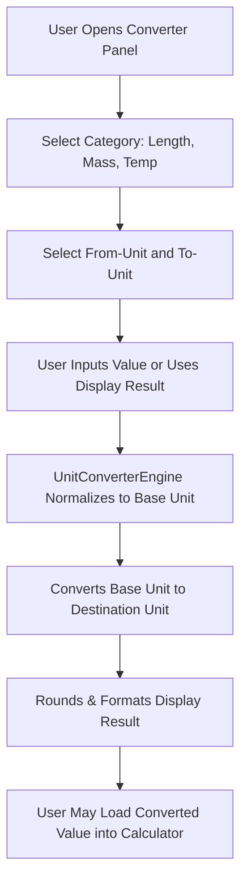

# User Flow: Multi-Unit Converter (F9)

## 1. Flow Diagram

## 2. Interaction States
- **SCR-CONV-01 (Converter Panel)**: Toggleable panel containing Category, From-Unit, To-Unit, and Convert button.
- **DEC-CONV-01 (Category Change)**: Selecting new category automatically resets unit dropdowns to category defaults.
- **REC-CONV-01 (Absolute Zero Guard)**: Converting temperatures below -273.15 C displays `'Invalid input'`.
