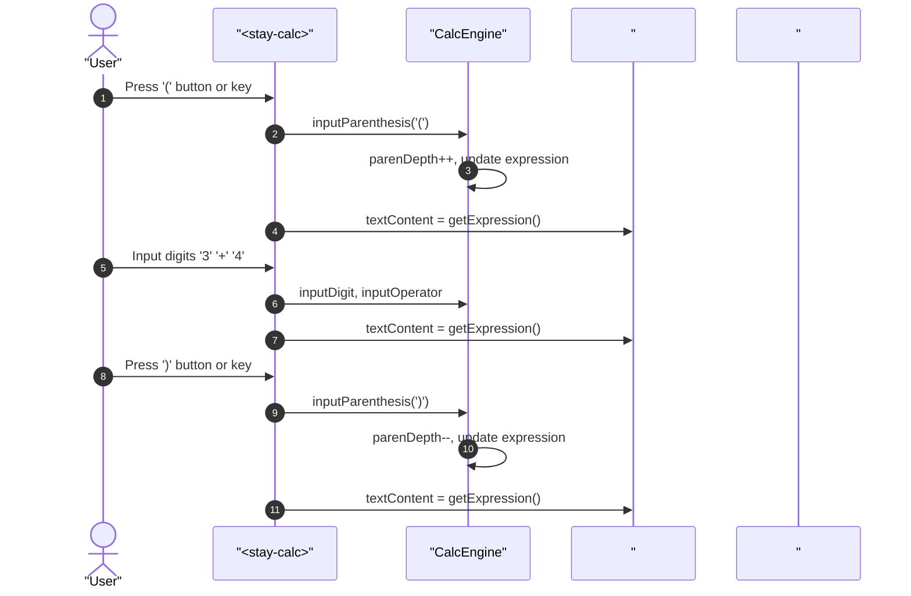
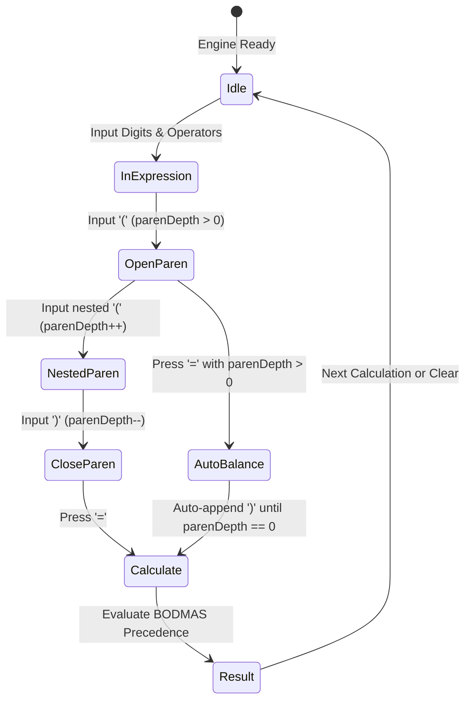

# User Flow: Formula Expression & Parentheses Precedence Flow

Authoritative interaction flows, decision gates, and recovery transitions for live formula expression display and parentheses evaluation in StayCalc.

## 1. Flow Overview & Bounds
- **Goal**: Render ongoing calculation formula in real-time display preview, accept nested parentheses input, evaluate expressions with algebraic precedence hierarchy, and auto-balance unclosed parentheses.
- **Primary Surface**: `<stay-calc>` shadow DOM display bar and `src/engine/calc-engine.ts`.
- **Actor Role**: `StandardUser`
- **Storage Tier**: In-memory instance state.
- **Latency Ceiling**: `<= 1ms` execution for mathematical evaluations.

## 2. Entry Points

| Entry ID | Trigger / Source | Preconditions | Target Surface | Inbound Flow |
| :--- | :--- | :--- | :--- | :--- |
| `ENT-EXPR-01` | Digit or decimal button / key input | Engine unlocked | `#expression-display` & `#display-value` | `FLW-EXPR-01` |
| `ENT-EXPR-02` | Operator button / key input (`+`, `-`, `*`, `/`, `^`) | Operand in buffer | `#expression-display` | `FLW-EXPR-02` |
| `ENT-EXPR-03` | Open parenthesis button or `(` key | Engine unlocked | `#expression-display` | `FLW-EXPR-03` |
| `ENT-EXPR-04` | Close parenthesis button or `)` key | `parenDepth > 0` | `#expression-display` | `FLW-EXPR-04` |
| `ENT-EXPR-05` | Calculate button (`=`) or `Enter` key | Expression active | `#expression-display` & `#display-value` | `FLW-EXPR-05` |
| `ENT-EXPR-06` | Backspace button (`⌫`) or `Backspace` key | Expression/buffer non-empty | `#expression-display` | `FLW-EXPR-06` |

## 3. Canonical Flow Sequences

### Flow 1: Live Expression Preview & Parentheses Input (`FLW-EXPR-01` to `FLW-EXPR-04`)

### Flow 2: Calculation with Unclosed Parentheses Auto-Balancing (`FLW-EXPR-05`)

## 4. Decision Logic & Error Recovery

| Decision ID | Condition | Action | Next State |
| :--- | :--- | :--- | :--- |
| `DEC-EXPR-01` | User inputs `)` when `parenDepth === 0` | Ignore `)` input to prevent unbalanced syntax | Maintain current state |
| `DEC-EXPR-02` | User presses `=` when `parenDepth > 0` | Auto-append `)` for each open level and evaluate | Transition to Result |
| `DEC-EXPR-03` | User enters operator after operator (e.g. `+ *`) | Replace previous operator per `RULE-CALC-007` | Update expression operator |
| `DEC-EXPR-04` | Expression divides by sub-expression evaluating to `0` | Trigger `RULE-CALC-001` error lock (`"Cannot divide by zero"`) | Error State |

| Recovery ID | Stall / Failure Condition | Recovery Mechanism | User Feedback |
| :--- | :--- | :--- | :--- |
| `REC-EXPR-01` | Unclosed parentheses on `=` | Append matching `)` before evaluation | Display computed result without syntax error |
| `REC-EXPR-02` | Division by zero in parentheses | Lock engine, display error | `#display-value` displays `"Cannot divide by zero"` |
| `REC-EXPR-03` | Backspace across closing/opening paren | Update `parenDepth` accordingly | Remove paren token from expression bar |
