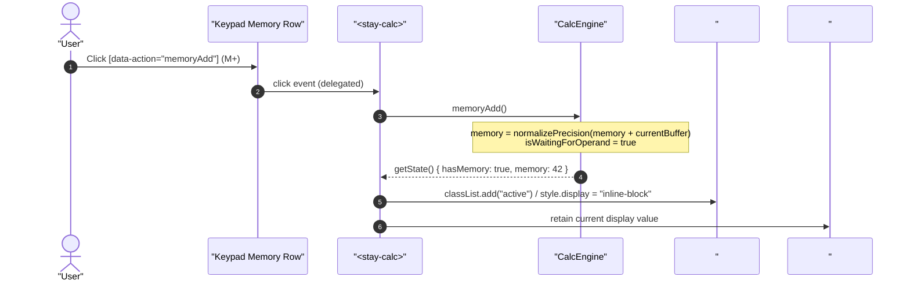
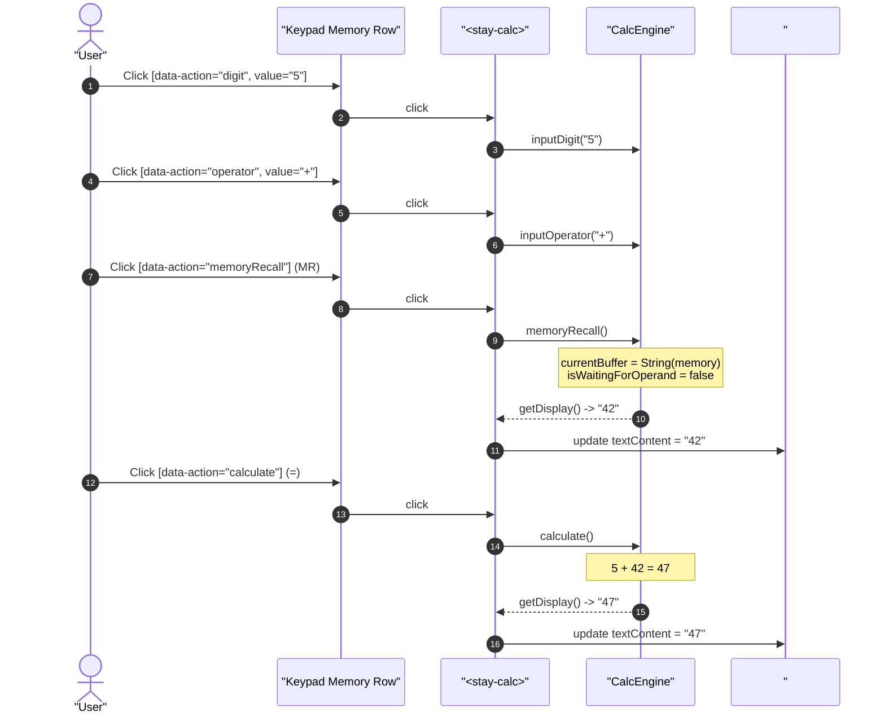
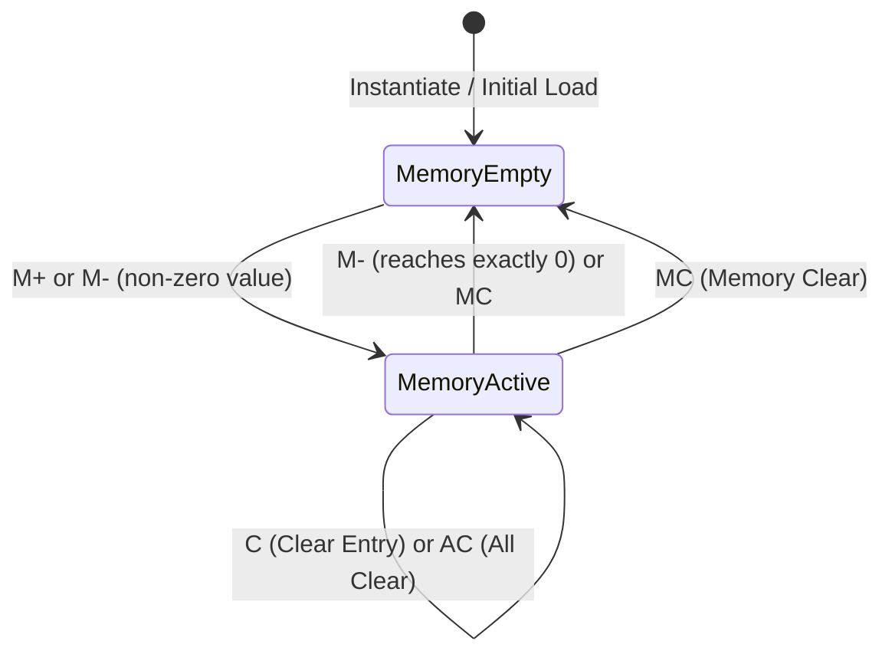

# User Flow: Memory Registers and Status Badge Flow

Authoritative screen states, interaction sequences, memory accumulator transitions, and reactive badge lifecycle for `<stay-calc>`.

---

## 1. Flow Overview & Interaction Bounds
- **Goal**: Enable users to accumulate, subtract, recall, and clear numeric values in a dedicated memory register, accompanied by an active visual `M` status badge.
- **Primary Surface**: `<stay-calc>` Autonomous Custom Element in `src/components/stay-calc.ts` and `CalcEngine` in `src/engine/calc-engine.ts`.
- **Actor Role**: `StandardUser`
- **Entry Trigger**: User clicks memory buttons (`M+`, `M-`, `MR`, `MC`) on the keypad.
- **Exit Outcome**: Synchronous update of memory register, active buffer, and `#memory-badge` visibility in Shadow DOM.
- **Storage Tier**: In-memory instance register (`CalcEngine.memory`).
- **Latency & SLA Bounds**: Immediate synchronous DOM update (`<= 1ms`).

---

## 2. Entry Points

| Entry ID | Trigger / Source | Preconditions | Initial Surface | Inbound Flow |
| :--- | :--- | :--- | :--- | :--- |
| `ENT-MEM-01` | Keypad `M+` / `M-` Click | Non-error display state | Keypad Memory Row | `FLW-MEM-01` |
| `ENT-MEM-02` | Keypad `MR` Click | Non-error display state | Keypad Memory Row | `FLW-MEM-02` |
| `ENT-MEM-03` | Keypad `MC` Click | Any state | Keypad Memory Row | `FLW-MEM-03` |

---

## 3. Canonical Flow Sequences

### Flow A: Memory Accumulation and Badge Activation Sequence

### Flow B: Memory Recall & Chained Operation Sequence

---

## 4. State Transitions

---

## 5. Decision Points & Dynamic Recovery

- **`DEC-MEM-01` (Division by Zero Guard)**:
  - *Condition*: `this.isLocked === true`.
  - *Action*: `memoryAdd()`, `memorySubtract()`, `memoryRecall()` immediately return without modifying memory register or active error display.
  - *Recovery*: User presses `C` or `AC` to unlock the arithmetic engine.
- **`DEC-MEM-02` (Memory Subtraction to Zero)**:
  - *Condition*: `memorySubtract()` causes `memory === 0`.
  - *Action*: `hasMemory()` evaluates to `false`. `#memory-badge` is reactively hidden (`style.display = "none"`, class `.active` removed).
- **`DEC-MEM-03` (MR Active Buffer Chaining)**:
  - *Condition*: `memoryRecall()` executed.
  - *Action*: `isWaitingForOperand = false`. The recalled memory value acts as an immediate numeric operand ready for subsequent operator ingestion or evaluation.

---

## 6. Exit Points

| Exit ID | Destination | Verification Check |
| :--- | :--- | :--- |
| `EXT-MEM-01` | Memory Active State | `hasMemory() === true`, `#memory-badge` visible |
| `EXT-MEM-02` | Memory Cleared State | `hasMemory() === false`, `getMemoryValue() === 0`, `#memory-badge` hidden |
