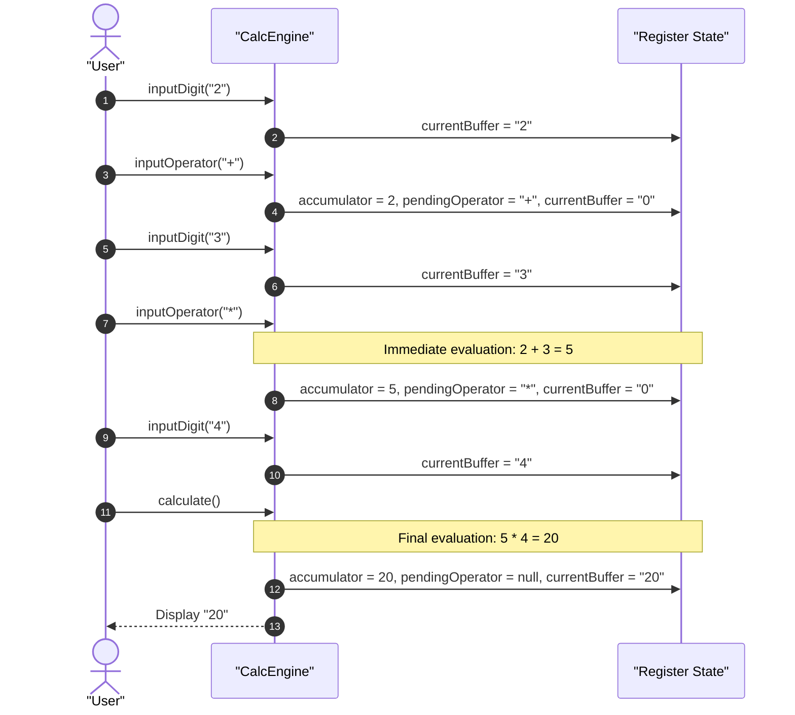
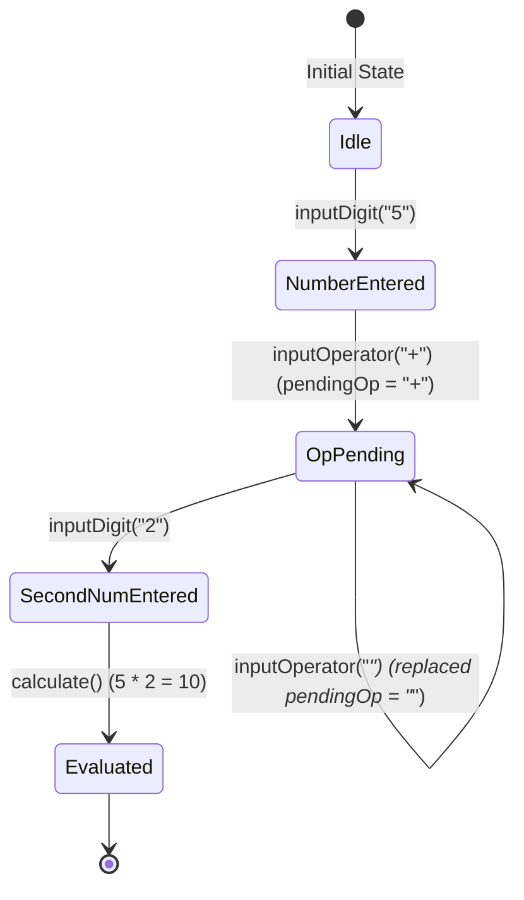
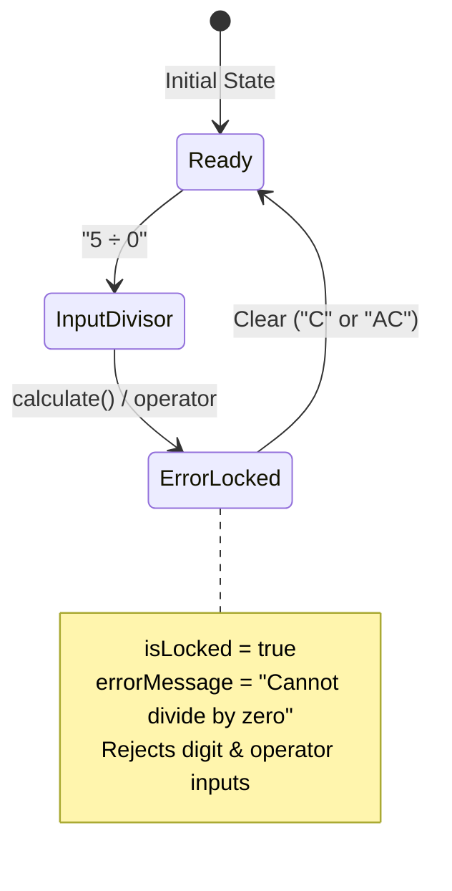

# User Flow: Precision Arithmetic Engine Logic & Flow

Authoritative register state machine, immediate evaluation logic, decision paths, and error recovery for the precision arithmetic engine.

---

## 1. Flow Overview & Interaction Bounds
- **Goal**: Evaluate left-to-right pocket calculator arithmetic, handle consecutive operator overrides, normalize decimal precision, and protect against division by zero.
- **Primary Surface**: `src/engine/` (Consumed by `<stay-calc>`)
- **Actor Role**: `StandardUser`
- **Entry Trigger**: User presses numeric key, decimal point, arithmetic operator (`+`, `-`, `*`, `/`), equals (`=`), Clear (`C`), or All Clear (`AC`).
- **Exit Outcome**: Updated display buffer, calculated accumulator value, or error message display.
- **Storage Tier**: In-memory instance registers (`accumulator`, `currentBuffer`, `pendingOperator`, `isLocked`, `errorMessage`).
- **Latency & SLA Bounds**: Synchronous evaluation within `<= 1ms`.

---

## 2. Entry Points

| Entry ID | Trigger / Source | Preconditions | Initial Surface | Inbound Flow |
| :--- | :--- | :--- | :--- | :--- |
| `ENT-CALC-01` | Digit / Decimal Key | Engine unlocked or fresh session | `CalcEngine` | `FLW-CALC-01` |
| `ENT-CALC-02` | Operator Key (`+`, `-`, `*`, `/`) | Valid operand or pending accumulator | `CalcEngine` | `FLW-CALC-02` |
| `ENT-CALC-03` | Equals Key (`=`) | Pending operator and second operand | `CalcEngine` | `FLW-CALC-03` |
| `ENT-CALC-04` | Clear Key (`C` / `AC`) | Any engine state (including locked error) | `CalcEngine` | `FLW-CALC-04` |

---

## 3. Canonical Flow Sequences

### Flow A: Immediate Execution Sequence (`2 + 3 * 4 = 20`)

### Flow B: Consecutive Operator Replacement (`5 + * 2 = 10`)

### Flow C: Division by Zero & Recovery Loop

---

## 4. Decision Trees & State Branches

- **`DEC-CALC-01` (Active Error Lock Check)**:
  - If `isLocked === true`:
    - If action is `clear()` or `allClear()` -> Execute reset and transition `isLocked = false`.
    - Else (digit, decimal, operator, calculate) -> Reject action with no-op.
- **`DEC-CALC-02` (Operator Ingestion State)**:
  - If `isWaitingForOperand === true` (operator already pressed, no digits entered since):
    - Replace `pendingOperator` with new operator (per `RULE-CALC-007`).
  - Else if `accumulator !== null` and `pendingOperator !== null`:
    - Evaluate intermediate operation left-to-right (per immediate execution model).
    - If divisor is `0` under division -> Transition to error lock (per `RULE-CALC-001`).
    - Else -> Commit intermediate result to `accumulator`, set `pendingOperator = newOp`.
  - Else:
    - Set `accumulator = parseBuffer(currentBuffer)`, set `pendingOperator = newOp`.
- **`DEC-CALC-03` (Decimal Point Ingestion)**:
  - If `currentBuffer` contains `.` -> Ignore keypress (no-op).
  - Else if `isWaitingForOperand === true` -> Set `currentBuffer = "0."`, clear waiting flag.
  - Else -> Append `.` to `currentBuffer`.

---

## 5. Error Recovery Paths

- **`REC-CALC-01` (Zero Division Recovery via C)**:
  - Trigger: User presses `C` while engine displays `"Cannot divide by zero"`.
  - Effect: Resets `currentBuffer = "0"`, `isLocked = false`, `errorMessage = null`. Preserves `accumulator` and `pendingOperator` if valid, allowing re-entry of divisor.
- **`REC-CALC-02` (Total Reset via AC)**:
  - Trigger: User presses `AC`.
  - Effect: Complete wipe of all registers (`accumulator = null`, `pendingOperator = null`, `currentBuffer = "0"`, `isLocked = false`, `errorMessage = null`).

---

## 6. Exit Points

| Exit ID | Destination | Trigger | Terminal State |
| :--- | :--- | :--- | :--- |
| `EXT-CALC-01` | Display Slot | Evaluation completed (`=`) | Display updated with normalized result |
| `EXT-CALC-02` | Display Slot | Division by zero | Display shows `"Cannot divide by zero"` |
| `EXT-CALC-03` | History Store | Successful evaluation | Calculation record emitted for storage |
