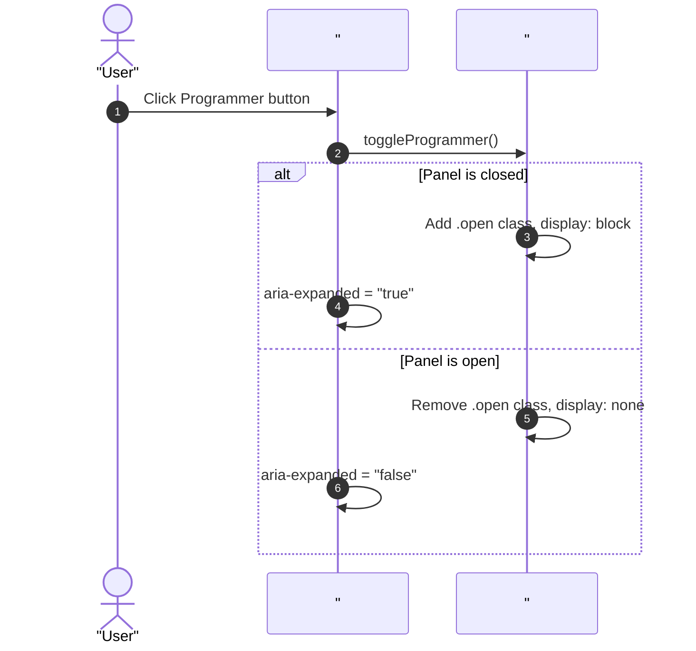
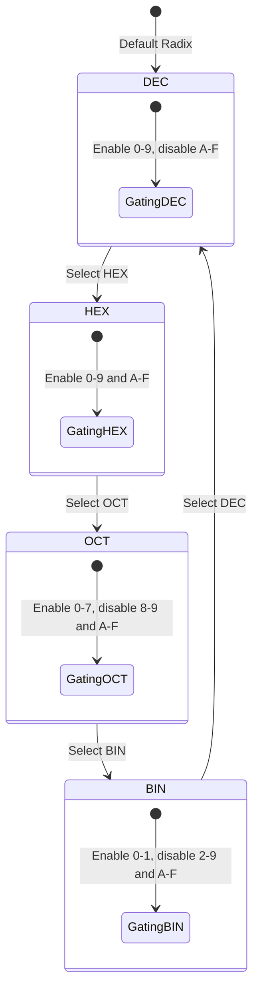

# User Flow: Programmer Radix Mode & Bitwise Interaction Flow

Authoritative interaction flows, decision gates, and recovery transitions for the StayCalc programmer calculation mode.

## 1. Flow Overview & Bounds
- **Goal**: Provide toggleable access to programmer calculations, real-time 4-base live synchronization (`HEX`, `DEC`, `OCT`, `BIN`), reactive keypad gating, word size clamping (`8`, `16`, `32`, `64`), and bitwise operations.
- **Primary Surface**: `<stay-calc>` shadow DOM and `src/engine/calc-engine.ts`.
- **Actor Role**: `StandardUser`
- **Storage Tier**: In-memory instance state.
- **Latency Ceiling**: `<= 1ms` execution for integer and bitwise calculations.

## 2. Entry Points

| Entry ID | Trigger / Source | Preconditions | Target Surface | Inbound Flow |
| :--- | :--- | :--- | :--- | :--- |
| `ENT-PROG-01` | `#programmer-toggle` button click | Interface rendered | `<stay-calc>` top-bar | `FLW-PROG-01` |
| `ENT-PROG-02` | `#radix-panel` base row click (`HEX`, `DEC`, `OCT`, `BIN`) | Programmer panel open | `#radix-panel` | `FLW-PROG-02` |
| `ENT-PROG-03` | `#word-size-select` button click | Programmer panel open | `#programmer-panel` | `FLW-PROG-03` |
| `ENT-PROG-04` | Bitwise operator button click (`&`, `|`, `^`, `~`, `<<`, `>>`) | Value in buffer | `#programmer-panel` | `FLW-PROG-04` |
| `ENT-PROG-05` | Hex digit button click (`A`–`F`) | Radix is `HEX` | `#programmer-panel` | `FLW-PROG-05` |

## 3. Canonical Flow Sequences

### Flow 1: Programmer Panel Toggle (`FLW-PROG-01`)

### Flow 2: Radix Base Switching & Keypad Gating (`FLW-PROG-02`)

## 4. Decision Trees & Domain Error Recovery

| Decision ID | Condition | Branch Yes | Branch No |
| :--- | :--- | :--- | :--- |
| `DEC-PROG-01` | Keypad input character matches active radix base | Append character to `currentBuffer` | Reject input, ignore keystroke |
| `DEC-PROG-02` | Active mode is Programmer and input is `.` | Reject input (integers only) | Process decimal point |
| `DEC-PROG-03` | Word size truncation after calculation | Apply `BigInt.asUintN(bits, BigInt(val))` | Keep unmasked value |
| `DEC-PROG-04` | Bitwise shift operand exceeds word size | Clamp shift count to `[0, wordSize - 1]` | Shift by operand |
| `DEC-PROG-05` | Base switched mid-number entry | Convert active value to target base string | Retain raw string |

### Recovery Loops (`REC-*`)
- **`REC-PROG-01` (Integer Division by Zero Recovery)**:
  - Error state locked: display shows `"Cannot divide by zero"`.
  - Recovery trigger: user clicks `C` or `AC` to unlock.
- **`REC-PROG-02` (Invalid Keypad Keystroke Rejection)**:
  - Keystroke outside valid radix set is intercepted via `event.preventDefault()`.
  - Engine remains in current valid state without error lock.
