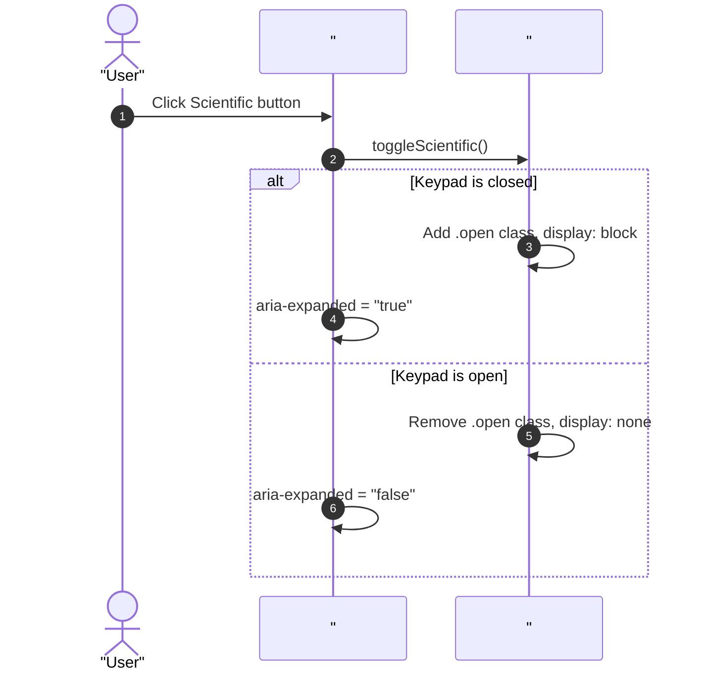
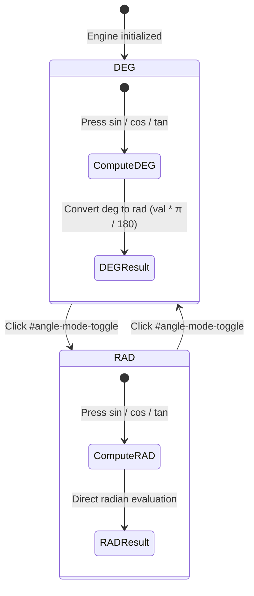

# User Flow: Scientific Mode & Advanced Arithmetic Flow

Authoritative interaction flows, decision gates, and recovery transitions for the StayCalc scientific calculation mode.

## 1. Flow Overview & Bounds
- **Goal**: Provide toggleable access to scientific operations, seamless angle mode selection, instant unary math execution, power operation chaining, and graceful domain error containment.
- **Primary Surface**: `<stay-calc>` shadow DOM and `src/engine/calc-engine.ts`.
- **Actor Role**: `StandardUser`
- **Storage Tier**: In-memory instance state.
- **Latency Ceiling**: `<= 1ms` execution for mathematical operations.

## 2. Entry Points

| Entry ID | Trigger / Source | Preconditions | Target Surface | Inbound Flow |
| :--- | :--- | :--- | :--- | :--- |
| `ENT-SCI-01` | `#scientific-toggle` button click | Interface rendered | `<stay-calc>` top-bar | `FLW-SCI-01` |
| `ENT-SCI-02` | `#angle-mode-toggle` button click | Scientific keypad visible | `#scientific-keypad` | `FLW-SCI-02` |
| `ENT-SCI-03` | Unary scientific function button click | Number in buffer | `#scientific-keypad` | `FLW-SCI-03` |
| `ENT-SCI-04` | Power operator button click (`xʸ` / `^`) | Operand in buffer | `#scientific-keypad` | `FLW-SCI-04` |
| `ENT-SCI-05` | Constant button click (`π`, `e`) | Engine unlocked | `#scientific-keypad` | `FLW-SCI-05` |

## 3. Canonical Flow Sequences

### Flow 1: Scientific Keypad Toggle (`FLW-SCI-01`)

### Flow 2: Angle Mode Toggle & Trigonometric Evaluation (`FLW-SCI-02`, `FLW-SCI-03`)

## 4. Decision Trees & Domain Error Recovery

| Decision ID | Condition | Branch Yes | Branch No |
| :--- | :--- | :--- | :--- |
| `DEC-SCI-01` | Unary function is `sqrt` and `val < 0` | Trigger `REC-SCI-01` (lock with `"Invalid input"`) | Compute `Math.sqrt(val)` |
| `DEC-SCI-02` | Unary function is `ln` or `log` and `val <= 0` | Trigger `REC-SCI-01` (lock with `"Invalid input"`) | Compute `Math.log` / `Math.log10` |
| `DEC-SCI-03` | Reciprocal `1/x` and `val === 0` | Trigger `REC-SCI-02` (lock with `"Cannot divide by zero"`) | Compute `1 / val` |
| `DEC-SCI-04` | `tan(val)` with `val % 180 === 90` in DEG | Trigger `REC-SCI-01` (lock with `"Invalid input"`) | Compute `Math.tan(rad)` |
| `DEC-SCI-05` | Constant `π` or `e` inserted | Replace buffer, set `isWaitingForOperand = true` | N/A |

### Recovery Loops (`REC-*`)
- **`REC-SCI-01` (Domain Boundary Error Recovery)**:
  - Error state locked: display shows `"Invalid input"`.
  - All digit, operator, and scientific buttons ignored.
  - Recovery trigger: user clicks `C` (Clear Entry) or `AC` (All Clear), restoring `isLocked = false`, `errorMessage = null`, buffer `"0"`.
- **`REC-SCI-02` (Zero Division Safeguard Recovery)**:
  - Error state locked: display shows `"Cannot divide by zero"`.
  - Recovery trigger: user clicks `C` or `AC` to unlock.
