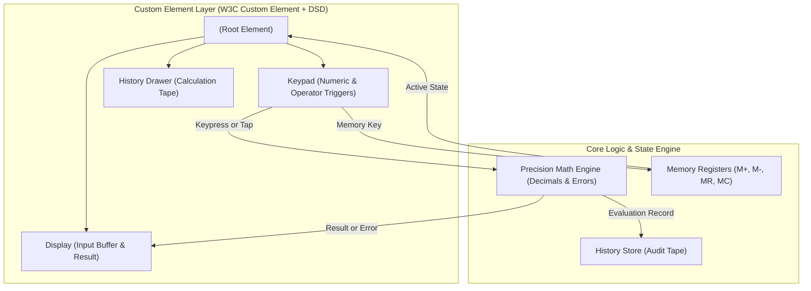

# StayCalc System Architecture

## 1. System Topology

StayCalc operates as a client-side web application anchored on a native W3C Autonomous Custom Element (`<stay-calc>`) with Declarative Shadow DOM (DSD) slot projections and a pure native arithmetic engine:

## 2. Component Boundaries

1. **`<stay-calc>`**: The top-level autonomous custom element managing the keyboard event listeners, visual display slot, keypad slot, and history drawer overlay.
2. **Precision Math Engine**: Pure, zero-dependency arithmetic module responsible for immediate evaluation, operator replacement (`5 + * 2` $\to$ `5 * 2`), division-by-zero protection, and floating-point error mitigation (`0.1 + 0.2` = `0.3`).
3. **Memory Coordinator**: State register managing `M+`, `M-`, `MR`, and `MC` operations, reflecting an active `M` badge on the display whenever memory $\ne 0$.
4. **History Tape**: Local storage store retaining past calculation records (`<operand1> <op> <operand2> = <result>`) with click-to-load capability.

## 3. Data Flow & Evaluation Lifecycle

- **Input Ingestion**: Button taps and physical keyboard events (`0-9`, `+`, `-`, `*`, `/`, `Enter`, `Escape`, `Backspace`) are captured by `<stay-calc>`.
- **Immediate Evaluation**: Operations execute sequentially (pocket calculator model: `2 + 3 * 4 = 20`).
- **Precision Normalization**: Decimal calculations are normalized to prevent IEEE 754 precision leakage.
- **Persistence**: Completed calculations are prepended to the local history tape.
