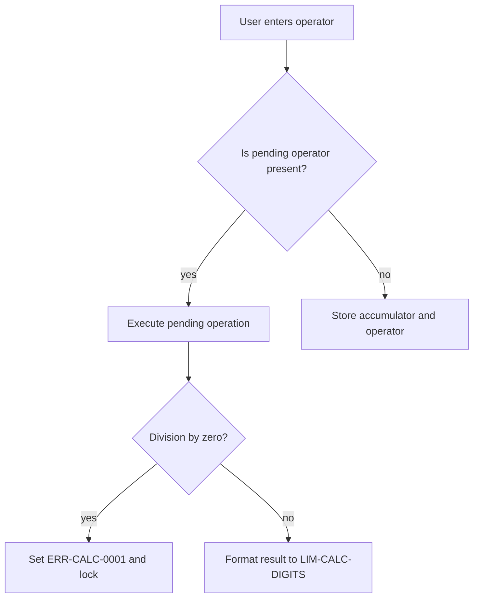

# Precision arithmetic engine

Up: [Arithmetic capability](../../../capabilities/arithmetic.md). Modules: [flow](./flow.md), [cases](./cases.md).

## In plain words

- The user enters numbers and operations on the calculator.
- Calculations evaluate sequentially from left to right as each operator is typed.
- Numbers round cleanly to ten display digits without floating-point errors.
- Clear Entry resets the current number while All Clear resets everything.
- Users can accumulate, subtract, and recall numbers using high-precision memory registers.

## How it works

The engine takes numbers and operators sequentially, applying immediate execution. Division by zero yields `ERR-CALC-0001`.

## Tier and risk

Proposed T2, confirmed by the owner: yes.

| Question | Answer |
| :--- | :--- |
| Data class | none |
| Blast radius | one user |
| Reversibility | undo |
| Residency | none |
| Recovery targets | not defined |

## Rules

- `RULE-CALC-001`: Division by zero returns `ERR-CALC-0001` and locks numeric input.
- `RULE-CALC-002`: Floating-point results round cleanly up to `LIM-CALC-DIGITS` digits.
- `RULE-CALC-007`: Sequential operations evaluate left-to-right immediately per `DEC-CALC-01`.
- `RULE-CALC-008`: Consecutive operator presses replace the pending operator in place.
- `RULE-CALC-009`: Clear Entry (C) resets active buffer to zero preserving accumulator.
- `RULE-CALC-010`: All Clear (AC) resets accumulator, buffer, operator, and error state.
- `RULE-CALC-011`: Memory Add (M+) accumulates current display value into memory register with high-precision normalization per `DEC-CALC-03`.
- `RULE-CALC-012`: Memory Subtract (M-) subtracts current display value from memory register with high-precision normalization per `DEC-CALC-03`.
- `RULE-CALC-013`: Memory Recall (MR) copies memory register value into active input buffer without modifying memory per `DEC-CALC-03`.
- `RULE-CALC-014`: Memory Clear (MC) resets memory register to zero (`LIM-CALC-MEMORY-DEFAULT`) per `DEC-CALC-03`.
- `RULE-CALC-015`: Memory register value persists across chained calculations and Clear Entry (C).
- `NEVER-CALC-001`: Never use dynamic code evaluation like eval or new Function.

## Examples

- **Sequential addition and multiplication.** Alice enters two plus three times four equals. The engine evaluates two plus three to five, then times four to twenty. The display shows twenty. Rules: `RULE-CALC-007`.
- **Consecutive operator replacement.** Bob enters five plus then presses multiply by two equals. The engine replaces plus with multiply and computes five times two. The display shows ten. Rules: `RULE-CALC-008`.
- **Floating point normalization.** Carol enters zero point one plus zero point two equals. The engine computes the sum and normalizes the decimal result. The display shows zero point three. Rules: `RULE-CALC-002`.
- **Memory accumulation and recall.** Dave enters ten then presses memory add, then enters five and presses memory recall. The display shows ten. Rules: `RULE-CALC-011`, `RULE-CALC-013`.

## Code anchors

- `src/engine/arithmetic.ts` `PrecisionArithmeticEngine.inputDigit`: Enforces input buffer entry (`RULE-CALC-002`).
- `src/engine/arithmetic.ts` `PrecisionArithmeticEngine.inputOperator`: Enforces sequential immediate execution (`RULE-CALC-007`, `RULE-CALC-008`).
- `src/engine/arithmetic.ts` `PrecisionArithmeticEngine.clear`: Enforces C buffer reset (`RULE-CALC-009`).
- `src/engine/arithmetic.ts` `PrecisionArithmeticEngine.allClear`: Enforces AC full reset (`RULE-CALC-010`).
- `src/engine/arithmetic.ts` `PrecisionArithmeticEngine.memoryAdd`: Enforces memory accumulation (`RULE-CALC-011`).
- `src/engine/arithmetic.ts` `PrecisionArithmeticEngine.memorySubtract`: Enforces memory subtraction (`RULE-CALC-012`).
- `src/engine/arithmetic.ts` `PrecisionArithmeticEngine.memoryRecall`: Enforces memory recall (`RULE-CALC-013`).
- `src/engine/arithmetic.ts` `PrecisionArithmeticEngine.memoryClear`: Enforces memory clear (`RULE-CALC-014`).

## Seams

- Cites `SEAM-CALC-01`.
