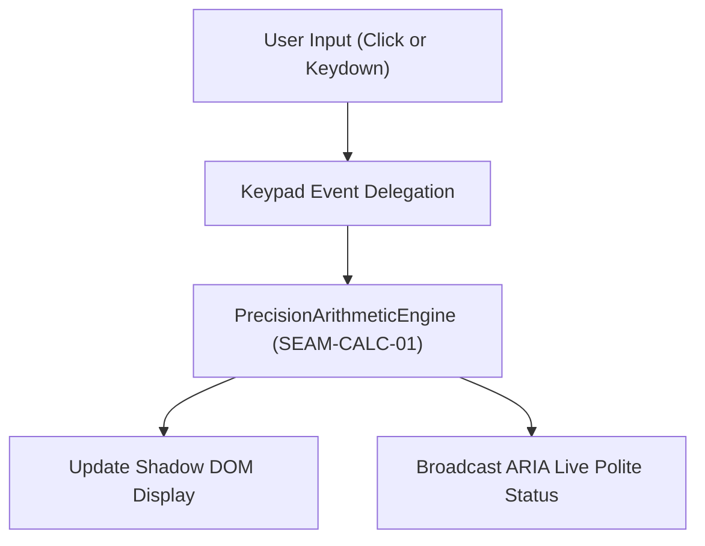

# Accessible web calculator component

Up: [Presentation capability](../../../capabilities/presentation.md). Modules: [flow](./flow.md), [cases](./cases.md).

## In plain words

- The user interacts with the calculator via mouse, touch, or physical keyboard.
- An autonomous custom element `<stay-calc>` encapsulates the keypad and display in an open Shadow DOM root.
- Physical keyboard keys (0-9, operators, Enter, Escape, Backspace) trigger immediate calculation updates.
- Visible focus rings, WCAG 2.2 AA contrast, and ARIA live announcements ensure accessibility across viewports down to 320px.

## How it works

The component encapsulates presentation and keypad interactions within an open Shadow DOM root, routing input tokens across `SEAM-CALC-01` into `PrecisionArithmeticEngine` and broadcasting status updates via an ARIA live region.

## Tier and risk

Proposed T2, confirmed by the owner: yes.

| Question | Answer |
| :--- | :--- |
| Data class | none |
| Blast radius | one user |
| Reversibility | immediate |
| Residency | none |
| Recovery targets | not defined |

## Rules

- `RULE-UI-001`: Autonomous custom element `<stay-calc>` registers and renders with Declarative Shadow DOM slot projection per `DEC-CALC-02`.
- `RULE-UI-002`: Keypad button clicks feed digits, decimals, and operators directly into `PrecisionArithmeticEngine` across `SEAM-CALC-01`.
- `RULE-UI-003`: Physical keyboard events (0-9, +, -, *, /, Enter, =, Escape, Backspace, Numpad) delegate to engine operations.
- `RULE-UI-004`: Interactive elements maintain visible `:focus-visible` focus rings and WCAG 2.2 AA contrast ratios.
- `RULE-UI-005`: Layout utilizes CSS logical properties and container queries ensuring zero horizontal scroll overflow across viewports down to `LIM-CALC-MIN-VIEWPORT`.
- `RULE-UI-006`: Status container with `aria-live="polite"` broadcasts calculation results and error notifications.
- `NEVER-UI-001`: Never introduce external runtime packages or styling dependencies.

## Examples

- **Keypad button calculation.** Alice clicks button 7, then plus, then button 8, then equals. The component calls the arithmetic engine and updates the display buffer to 15. Rules: `RULE-UI-002`.
- **Physical keyboard entry.** Bob presses key 4 followed by asterisk, 5, and Enter on his physical keyboard. The component delegates key events to the arithmetic engine and updates the display to 20. Rules: `RULE-UI-003`.
- **Accessible screen reader announcement.** Carol types 9 divided by 0 equals on a screen reader. The ARIA live region politely announces the error string `Cannot divide by zero`. Rules: `RULE-UI-006`.

## Code anchors

- `src/ui/stay-calc.ts` `StayCalc.connectedCallback`: Custom element lifecycle registration and shadow root initialization (`RULE-UI-001`).
- `src/ui/stay-calc.ts` `StayCalc.handleKeypadClick`: Keypad click delegation to engine (`RULE-UI-002`).
- `src/ui/stay-calc.ts` `StayCalc.handleKeyDown`: Physical keyboard listener and normalizer (`RULE-UI-003`).
- `src/ui/stay-calc.styles.ts` `stayCalcStyles`: CSS logical properties, focus rings, and container queries (`RULE-UI-004`, `RULE-UI-005`).
- `src/ui/stay-calc.template.ts` `renderStayCalcTemplate`: DSD shadow root template and ARIA live status node (`RULE-UI-001`, `RULE-UI-006`).

## Seams

- Cites `SEAM-CALC-01`.
