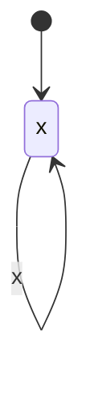

# Entity statuses

Up: [README](../README.md). The lifecycle of one entity is drawn once, here or in the owning slice's `state.md`; other pages link to it.

| Entity | Status | Meaning | Who may move it |
| :--- | :--- | :--- | :--- |
| x | x | x | x |
