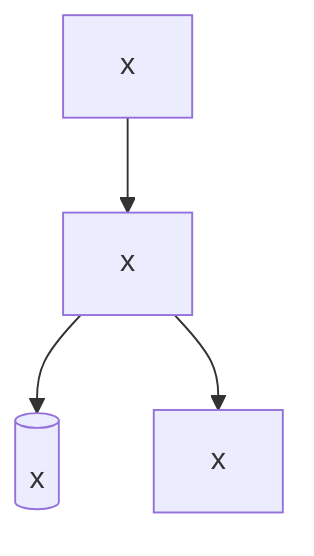

# Scope, principles and architecture

Up: [README](../README.md). Next: [actors](./actors.md). Decisions behind this page are `DEC-*` entries in the decisions catalog.

x

## Principles

1. **x.** x

## Out of scope

x

## Runtime shape

One sentence per box: what runs there and who owns it. Vendors are listed in [third-party dependencies](./third-party-dependencies.md).
